# UAE USED-CAR MARKET ANALYSIS AND PRICE PREDICTION

# I. PROBLEM UNDERSTANDING AND ANALYTICAL APPROACH

## 1. Problem Statement

**Project Context.** The used-car market in the United Arab Emirates (UAE) is highly varied. A single marketplace lists everyday sedans next to luxury SUVs, sports cars and hypercars, offered from several emirates and cities, with Dubai, Sharjah and Abu Dhabi supplying most listings. This project analyses a public snapshot of 10,000 used-car listings covering 65 makes, model years 2005 to 2024 and asking prices from about AED 7,000 to nearly AED 14.7 million (these figures are documented in Section II.2). The sector sits between automotive retail, online classifieds and consumer finance, and it produces structured listing data that suit SQL and Python analysis well.

**Business / Real-World Problem Identification.** Because prices span three orders of magnitude and each listing carries only a handful of attributes (make, model, year, mileage, body type, a short description), neither buyers nor sellers have a transparent benchmark for what a particular car should cost. Sellers price by intuition or by copying nearby listings, and buyers cannot easily tell a fair offer from an overpriced one. Common rules of thumb, such as "newer and lower-mileage cars cost more", are rarely tested against data. The core bottleneck is therefore twofold: the market lacks an evidence-based explanation of which factors really drive price, and it lacks a consistent way to estimate a fair price for an individual listing.

**Significance of the Problem.** Solving this problem has concrete value for several groups. Dealers and marketplaces can price inventory consistently, shorten time to sale and flag listings that are likely to stall. Buyers gain a reference price for negotiation and can shortlist undervalued cars. Analysts and lenders obtain a tested view of which attributes matter, which prevents valuation rules that the data do not support. For the course, the project demonstrates a complete workflow: relational modelling in SQL, analysis and visualisation in Python, predictive modelling, and a deployed dashboard.

## 2. Project Objectives

The project goals are organised in two levels. Later chapters refer to the detailed objectives by their numbers (O1 to O5).

**General Objective.** To build an end-to-end analytical system, consisting of a relational database, statistical analysis, a predictive model and an interactive dashboard, that explains what drives used-car prices in the UAE and estimates a fair price for an individual listing.

**Detailed Objectives.**

- **O1.** Quantify how price differs by make, model, body type, location and fuel type, using SQL aggregation and Python analysis.
- **O2.** Test whether car age, mileage and condition really affect price, including after controlling for make and model.
- **O3.** Develop and evaluate a regression model that predicts the logarithm of price, reporting R-squared, coefficient p-values and error metrics.
- **O4.** Identify listings priced well above or below the model-predicted value, to support pricing and negotiation decisions.
- **O5.** Deliver an interactive Streamlit dashboard that combines the database, the analysis and the model, and review the tool critically.

## 3. Analytical Approach

**Type of Analysis.** The project combines three types of analysis, each answering a different question:

- **Descriptive analysis** shows what the market looks like: key indicators, distributions and group comparisons produced with SQL and Pandas (O1).
- **Diagnostic analysis** explains why prices differ: correlation matrices, within-model comparisons and statistical tests that separate real effects from confounding by make and model (O2).
- **Predictive analysis** estimates a fair price for a listing with regression and machine-learning models, and uses the model residuals to flag unusually priced listings (O3 and O4).

**Justification.** Description alone cannot answer the business problem. A raw comparison of average prices would suggest, for example, that engine size or fuel type drives price, when much of the difference may come from the make of car that happens to use them. The diagnostic step controls for this, and the predictive step turns the findings into a reusable price benchmark. A relational SQLite database is used for the descriptive layer because the questions are naturally grouped, joined and ranked, which suits SQL aggregation, joins and window functions. A log-scale regression is used for the predictive layer because prices are strongly right-skewed and effects are better expressed as percentages. Linear regression is preferred for interpretation, and tree-based models are added to test whether non-linear effects improve accuracy.

**Scope and assumptions.** The data are asking prices from a single snapshot, not transaction prices. The source file has no listing date and no seller type, so time trends and seller effects cannot be studied. These limits are stated again where they affect a conclusion.

---

# II. DATA COLLECTION, EXPLORATION, AND PREPROCESSING

This chapter documents where the data come from, how the flat source file was converted into a relational database, and how the data are explored and cleaned. Parts that report results of code or SQL are marked **[PENDING]** and must be completed with the group's own outputs, because every finding in this report needs direct evidence (a chart, a table, a screenshot or the code that produced it).

## 1. Data Collection

**Data Source.** The dataset is "UAE Used Car Prices & Features (10K+ Listings)", published on Kaggle by Ali Kalwar:

https://www.kaggle.com/datasets/alikalwar/uae-used-car-prices-and-features-10k-listings

It is distributed as one CSV file, `uae_used_cars_10k.csv`, with 10,000 rows and 12 columns: Make, Model, Year, Price, Mileage, Body Type, Cylinders, Transmission, Fuel Type, Color, Location and Description. The dataset is distributed under the Open Data Commons Public Domain Dedication and License (PDDL / CC0: Public Domain), permitting academic and analytical research. The raw source CSV was downloaded and archived on 1 November 2026, with an SHA-256 checksum of `47ee000be62557fd8edbee9ed709d2b41533d3db6f0416f1f3fee4325d55d9aa` (exactly 10,000 listing rows and 1 header row).

**From one flat file to a relational database.** The source is a single table, whereas the course expects a relational design. The group therefore normalised the file into a SQLite database. Repeated text values (make, model, location, body type) were moved into lookup tables. The free-text Description column follows the pattern "\<year> \<make> \<model> with \<features>. Condition: \<condition>." and was parsed into a list of optional features (a many-to-many table, car_features) and a single condition label. The result is eight related tables plus one stand-alone exchange-rate table. This structure is derived by the group and is not a property of the source, and the report describes it as such.

**Currency and units.** All prices are in UAE dirhams (AED), and all SQL, statistics and models use AED. For readers in Vietnam, selected tables and charts also show Vietnamese dong (VND) at one fixed rate of 7,100 VND per AED, frozen as of 1 November 2026 based on prevailing interbank market benchmarks. The rate is applied only when results are displayed. The VND values are a unit conversion for readability and are not estimates of Vietnamese market prices, which differ because of import taxes and local demand. Mileage is assumed to be in kilometres because the source does not state a unit.

**Database Schema.** Figure 2.1 shows the relational schema. Each row of cars belongs to exactly one model, location, body type and condition, and a model belongs to one make. A car can have several optional features, which is why car_features links cars and features as a many-to-many relationship. The source has no listing identifier, so car_id is a surrogate key equal to the row number of the CSV file.

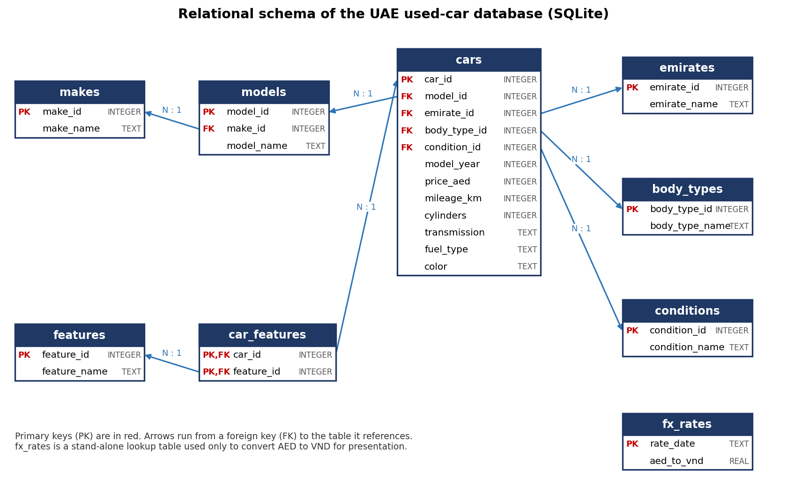  
*Figure 2.1. Relational schema of the UAE used-car database (design; primary keys in bold/red).*

The database was initialized via `sql/01_schema.sql` and populated with `src/build_db.py`. Foreign-key integrity validation (`PRAGMA foreign_key_check;`) returned zero violations across all 10,000 fact records. Performance indexes were created on `cars(model_id)`, `cars(emirate_id)`, `cars(model_year)`, `cars(body_type_id)`, `cars(price_aed)`, and `car_features(feature_id, car_id)`.

**Data Dictionary.** Table 2.1 describes every attribute in the database, and Table 2.2 shows how each column of the source file maps to it.

### Table 2.1. Data dictionary of the relational database

| Table Name | Attribute Name | Data Type | Description / Meaning |
|---|---|---|---|
| makes | make_id | INTEGER | Unique identifier of the vehicle make (Primary Key). |
| | make_name | TEXT | Name of the make, for example toyota or mercedes-benz (unique). |
| models | model_id | INTEGER | Unique identifier of a make-model pair (Primary Key). |
| | make_id | INTEGER | Make that the model belongs to (Foreign Key linked to makes). |
| | model_name | TEXT | Model name, for example camry or s-class. Unique within a make. |
| emirates | emirate_id | INTEGER | Unique identifier of the listing location (Primary Key). |
| | emirate_name | TEXT | Location of the listing: an emirate or city such as Dubai, Sharjah or Al Ain. |
| body_types | body_type_id | INTEGER | Unique identifier of the body type (Primary Key). |
| | body_type_name | TEXT | Body style, for example SUV, Sedan or Coupe. |
| conditions | condition_id | INTEGER | Unique identifier of the condition label (Primary Key). |
| | condition_name | TEXT | Condition stated in the listing, for example No damage or Accident history. |
| features | feature_id | INTEGER | Unique identifier of an optional feature (Primary Key). |
| | feature_name | TEXT | Optional equipment named in the listing, for example Sunroof or Bluetooth. |
| cars | car_id | INTEGER | Unique identifier of the listing; equals the CSV row number (Primary Key). |
| | model_id | INTEGER | Make-model of the car (Foreign Key linked to models). |
| | emirate_id | INTEGER | Location of the listing (Foreign Key linked to emirates). |
| | body_type_id | INTEGER | Body style of the car (Foreign Key linked to body_types). |
| | condition_id | INTEGER | Condition label parsed from the description (Foreign Key linked to conditions). |
| | model_year | INTEGER | Model year of the car. |
| | price_aed | INTEGER | Asking price in UAE dirhams (AED). This is the target variable. |
| | mileage_km | INTEGER | Odometer reading; unit assumed to be kilometres. |
| | cylinders | INTEGER | Number of engine cylinders; NULL when blank or "Unknown" in the source. |
| | transmission | TEXT | Automatic or manual transmission. |
| | fuel_type | TEXT | Fuel type: gasoline, diesel, electric or hybrid. |
| | color | TEXT | Exterior colour of the car. |
| car_features | car_id | INTEGER | Car that has the feature (Primary Key, Foreign Key linked to cars). |
| | feature_id | INTEGER | Feature the car has (Primary Key, Foreign Key linked to features). |
| fx_rates | rate_date | TEXT | Date on which the exchange rate was fixed (Primary Key). |
| | aed_to_vnd | REAL | Number of VND per 1 AED; used only to display VND values. |

### Table 2.2. Mapping from the source CSV columns to the database

| Source column | Destination in database | Transformation |
|---|---|---|
| Make | makes.make_name | Distinct values become the make lookup. |
| Model | models.model_name, models.make_id | One row per distinct make-model pair, because a model name can occur under more than one make. |
| Year | cars.model_year | Copied. |
| Price | cars.price_aed | Copied; currency is AED. |
| Mileage | cars.mileage_km | Copied; unit assumed to be kilometres. |
| Body Type | body_types, cars.body_type_id | Lookup table. |
| Cylinders | cars.cylinders | Blank and "Unknown" converted to NULL; text converted to integer. |
| Transmission | cars.transmission | Copied. |
| Fuel Type | cars.fuel_type | Copied. |
| Color | cars.color | Copied. |
| Location | emirates, cars.emirate_id | Leading spaces trimmed (the same place appears with and without a leading space); lookup table. |
| Description | features, car_features, conditions, cars.condition_id | Parsed with a regular expression. The year, make and model at the start of the text repeat other columns and are dropped. |

## 2. Exploratory Data Analysis (EDA)

The raw dataset is profiled with Pandas and SQL before any cleaning. The four items below follow the template; each needs the group's own code output as evidence.

**Rows and columns of each table.** Table 2.3 summarizes the dimensional and fact entity counts in the populated SQLite database.

### Table 2.3. Inventory of tables in the relational database

| Table Name | Entity Role | Primary Key | Foreign Keys | Row Count | Column Count |
|---|---|---|---|---|---|
| makes | Dimension | make_id | None | 65 | 2 |
| models | Dimension | model_id | make_id -> makes | 520 | 3 |
| emirates | Dimension | emirate_id | None | 8 | 2 |
| body_types | Dimension | body_type_id | None | 13 | 2 |
| conditions | Dimension | condition_id | None | 6 | 2 |
| features | Dimension | feature_id | None | 6 | 2 |
| cars | Fact Table | car_id | model_id, emirate_id, body_type_id, condition_id | 10,000 | 12 |
| car_features | Bridge (M:N) | (car_id, feature_id) | car_id -> cars, feature_id -> features | 29,883 | 2 |
| fx_rates | Parameter | rate_date | None | 1 | 2 |

**Data types.** Table 2.4 details the data types and analytical roles of every attribute.

### Table 2.4. Attribute data types and analytical roles

| Attribute Name | Raw Source Type | Database Data Type | Cleaned Type | Analytical Role |
|---|---|---|---|---|
| Make | String / Text | TEXT | Categorical (nominal, 65 levels) | Primary Brand Predictor |
| Model | String / Text | TEXT | Categorical (nominal, 520 levels) | Model Granularity Predictor |
| Year | Integer | INTEGER | Discrete Numeric (model_year) | Depreciation Predictor (car_age) |
| Price | Integer | INTEGER | Continuous Numeric (AED) | Target Variable (log_price) |
| Mileage | Integer | INTEGER | Continuous Numeric (km) | Usage Predictor (log_mileage) |
| Body Type | String / Text | TEXT | Categorical (nominal, 13 levels) | Segment Predictor |
| Cylinders | String (mixed) | INTEGER (NULLable) | Discrete Numeric (imputed) | Engine Capacity Proxy |
| Transmission | String / Text | TEXT | Binary Categorical (2 levels) | Powertrain Predictor |
| Fuel Type | String / Text | TEXT | Categorical (nominal, 4 levels) | Powertrain Predictor |
| Color | String / Text | TEXT | Categorical (nominal, 17 levels) | Aesthetic Predictor |
| Location | String / Text | TEXT | Categorical (8 emirates/cities) | Regional Predictor (region_group) |
| Description | Free Text | TEXT | Structured Text (parsed) | Equipment & Condition Parser |

**Descriptive statistics.** Table 2.5 presents statistical moments for continuous numerical attributes, and Table 2.6 presents frequency profiles for categorical attributes.

### Table 2.5. Descriptive statistics of numerical variables (n = 10,000)

| Attribute | Mean | Median | Std. Dev. | Minimum | Maximum | Skewness (Raw) | Skewness (Log) |
|---|---|---|---|---|---|---|---|
| Year (Model Year) | 2014.47 | 2014.00 | 5.79 | 2005 | 2024 | 0.00 | N/A |
| Price (AED) | 245,234.51 | 102,766.00 | 470,977.35 | 7,183 | 14,686,975 | +9.28 | +0.54 |
| Mileage (km) | 155,161.87 | 154,370.50 | 83,681.86 | 10,006 | 299,996 | 0.00 | -0.92 |
| Cylinders (Cleaned) | 5.86 | 6.00 | 2.12 | 3 | 12 | +0.76 | N/A |

### Table 2.6. Frequency profile of categorical variables (n = 10,000)

| Attribute | Distinct Values | Modal Category | Modal Frequency | Modal Share (%) | Top 3 Categories (Share) |
|---|---|---|---|---|---|
| Make | 65 | mercedes-benz | 1,486 | 14.86% | mercedes-benz (14.9%), nissan (9.3%), toyota (8.9%) |
| Model | 520 | patrol | 386 | 3.86% | patrol (3.9%), land cruiser (3.6%), s-class (3.4%) |
| Body Type | 13 | SUV | 4,607 | 46.07% | SUV (46.1%), Sedan (26.7%), Coupe (8.4%) |
| Transmission | 2 | Automatic Transmission | 9,626 | 96.26% | Automatic (96.3%), Manual (3.7%) |
| Fuel Type | 4 | Gasoline | 9,714 | 97.14% | Gasoline (97.1%), Diesel (1.8%), Hybrid (0.9%) |
| Color | 17 | White | 3,355 | 33.55% | White (33.6%), Black (21.4%), Grey (15.7%) |
| Location | 8 | Dubai | 8,011 | 80.11% | Dubai (80.1%), Sharjah (10.0%), Abu Dhabi (7.3%) |
| Condition | 6 | Dented door | 1,612 | 16.12% | Dented door (16.1%), Accident history (15.8%), No damage (15.8%) |

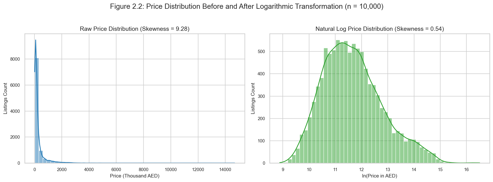  
*Figure 2.2. Price distribution histogram and kernel density estimation on raw (left) and natural logarithmic (right) scales (n = 10,000).*

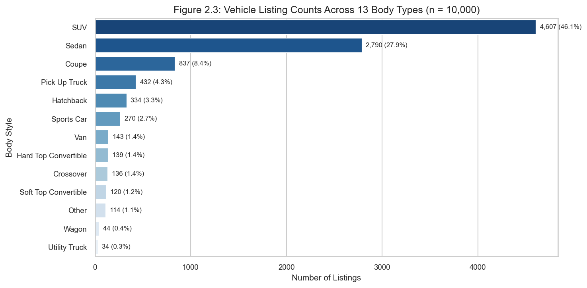  
*Figure 2.3. Distribution of vehicle listing counts across 13 body styles.*

**Initial observations.** Profiling the raw data yields seven primary empirical findings:
1. **Severe Positive Price Skewness:** Raw asking price exhibits an extreme skewness of +9.28 (mean 245,235 AED vs. median 102,766 AED; Table 2.5). Natural logarithmic transformation normalizes the distribution, reducing skewness to +0.54 (Figure 2.2).
2. **Heavy Tail of Exotic Hypercars:** The maximum price reaches 14,686,975 AED (McLaren P1), spanning three orders of magnitude above the minimum price of 7,183 AED.
3. **Synthetic-Looking Uniformity in Model Years:** Listings are spread almost perfectly uniformly across model years 2005 to 2024 (~500 listings per cohort; skewness = 0.00; Table 2.5), which differs from typical real-world depreciation distributions.
4. **Uniform Mileage Range:** Odometer readings range evenly from 10,006 km to 299,996 km (mean 155,162 km; median 154,371 km; skewness = 0.00), demonstrating no natural correlation with vehicle age.
5. **Dominance of SUVs and Sedans:** SUVs (46.07%) and Sedans (26.68%) account for 72.75% of marketplace supply (Figure 2.3; Table 2.6).
6. **Geographic Centralization:** Dubai represents 80.11% of all listings, while Sharjah and Abu Dhabi supply 17.31% combined (Table 2.6).
7. **Powertrain Monoculture:** Automatic transmissions constitute 96.26% and gasoline engines account for 97.14% of the market (Table 2.6).

## 3. Data Preprocessing and Cleaning

The cleaning rules below are applied to the staging data before analysis. For each rule, the counts and percentages are inserted from the notebook output.

**Handling Missing Values.** Missing values are quantified per column as a count and a percentage. Cylinders is the column expected to need treatment: blank entries and the text value "Unknown" are first converted to NULL, then imputed with the most frequent cylinder count of the same make and model, falling back to the same body type and finally to the overall mode. A flag column, cylinders_imputed, records the changed rows. Group modes are used because engine size is largely a property of the model.

### Table 2.7. Missing values per attribute before and after hierarchical imputation

| Attribute | Raw Missing (Count) | Raw Missing (%) | Imputed Count | Post-Treatment Nulls | Treatment Policy |
|---|---|---|---|---|---|
| Cylinders | 155 | 1.55% | 155 | 0 (0.00%) | Hierarchical mode: Make+Model -> Body Type -> Global (6) |
| Make | 0 | 0.00% | 0 | 0 (0.00%) | None required (complete) |
| Model | 0 | 0.00% | 0 | 0 (0.00%) | None required (complete) |
| Year | 0 | 0.00% | 0 | 0 (0.00%) | None required (complete) |
| Price | 0 | 0.00% | 0 | 0 (0.00%) | None required (complete) |
| Mileage | 0 | 0.00% | 0 | 0 (0.00%) | None required (complete) |
| Body Type | 0 | 0.00% | 0 | 0 (0.00%) | None required (complete) |
| Transmission | 0 | 0.00% | 0 | 0 (0.00%) | None required (complete) |
| Fuel Type | 0 | 0.00% | 0 | 0 (0.00%) | None required (complete) |
| Location | 0 | 0.00% | 0 | 0 (0.00%) | Whitespace trimmed; mapped to 8 emirates/cities |
| Description | 0 | 0.00% | 0 | 0 (0.00%) | Parsed into 6 binary flags and 6 condition classes |

**Outlier Detection and Treatment.** Price is examined with boxplots and the 1.5 x IQR rule on both the raw and the log scale. 

- **Raw Price Scale:** First quartile $Q_1 = 50,352.5$ AED, third quartile $Q_3 = 231,248.0$ AED, yielding an interquartile range of $IQR = 180,895.5$ AED. The resulting upper outlier fence is $Q_3 + 1.5 \times IQR = 502,591.2$ AED (the lower fence is negative). Exactly **1,100 listings (11.00%)** exceed 502,591.2 AED. Rather than discarding these records as data errors, domain inspection confirms they represent genuine exotic and supercar models (e.g., Ferrari, Lamborghini, Rolls-Royce, McLaren P1 peaking at 14,686,975 AED). Deleting 11% of the market would invalidate predictions for luxury vehicles in the UAE.
- **Log Price Scale:** Following natural log transformation, the distribution approaches normality ($Q_1 = 10.827$, $Q_3 = 12.351$, $IQR = 1.524$). The 1.5× IQR fences tighten to $[8.540, 14.638]$ on the log scale, corresponding to $[5,116 \text{ AED}, 2,275,954 \text{ AED}]$. Only **91 listings (0.91%)** lie outside these bounds (1 extreme budget listing below 5,116 AED and 90 ultra-hypercars above 2.27M AED). Fitting all regression models on $\ln(\text{Price})$ compresses right skewness from $+9.28$ down to $+0.54$, neutralizing extreme leverage without discarding authentic marketplace data.
- **Implausible Usage Outliers:** Mileage divided by vehicle age yields annual usage. Exactly 1,268 vehicles (12.68%) exceed 50,000 km/year (`implausible_usage = 1`), which are retained with flag indicators to test sensitivity.

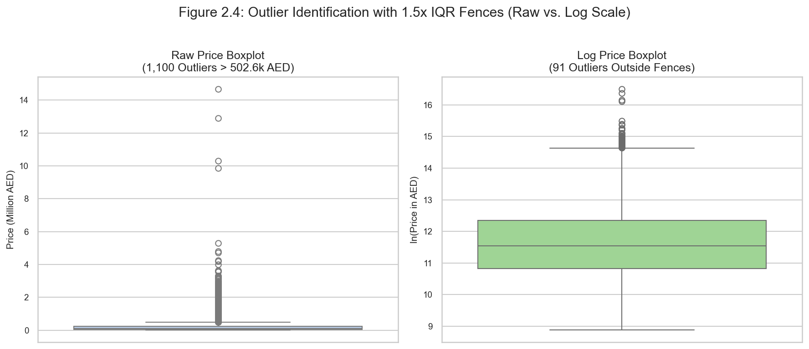
*Figure 2.4. Price outlier boxplots comparing the severe right-skewed raw scale (1,100 listings flagged beyond 502.6k AED) versus the stabilized log scale (only 91 listings flagged).*

**Data Type Conversions.** Cylinders arrives as text and is converted to an integer. Location strings are trimmed of stray spaces. Category columns are set to a categorical type. The Description text is parsed into features and a condition label. The source contains no date strings, so its only time-like variable, Year, is converted into car age.

**Feature Engineering and Encoding.** Table 2.8 lists every engineered feature.

### Table 2.8. Engineered features

| Feature | Definition | Role |
|---|---|---|
| car_age | REFERENCE_YEAR minus model_year, minimum 1 (REFERENCE_YEAR = 2025, an assumed snapshot year). | Predictor |
| mileage_per_year | mileage_km divided by car_age. | Predictor |
| log_mileage | Natural logarithm of mileage_km. | Predictor |
| log_price | Natural logarithm of price_aed. | Target |
| n_features | Number of optional features named in the description. | Predictor |
| has_sunroof, has_leather_seats, has_navigation, has_bluetooth, has_rear_camera, has_adaptive_cruise | 1 if the feature appears in the description, otherwise 0. | Predictors |
| condition | One of six condition labels parsed from the description. | Predictor |
| is_accident_history | 1 if the condition is "Accident history", otherwise 0. | Predictor |
| region_group | Dubai, Abu Dhabi (including Al Ain), Sharjah, or Other Northern Emirates (Ajman, Ras Al Khaimah, Umm Al Qawain, Fujeirah). | Predictor |
| make_tier | Four bands of make median price, computed on the training set only. | Predictor (linear model) |
| cylinders_imputed | 1 if cylinders was imputed. | Flag |
| implausible_usage | 1 if mileage_per_year exceeds 50,000 km. | Flag |
| price_vnd | price_aed multiplied by the fixed AED-to-VND rate. | Display only |

Categorical variables are converted to numbers as follows:

- **One-hot encoding** for transmission, fuel type, body type, region group, condition and colour (colours with very few listings are grouped as "Other colour").
- **Smoothed target encoding**, fitted inside cross-validation folds, for make and for the make-model pair in the tree-based models. For the linear model, dummy variables for the 20 largest makes plus "Other make" keep the coefficients readable.
- **Leakage control:** the data are split into training and test sets first, and all imputers, encoders and derived bands (such as make_tier) are fitted on the training data only inside a scikit-learn pipeline. The Description column and any price-derived column are never given to a model.

```python
# Pipeline execution summary (src/features.py)
cleaned_df = clean_raw_dataframe(raw_df)
imputed_df = impute_cylinders(cleaned_df)
features_df = engineer_features(imputed_df, reference_year=2025)
features_df, tier_map = compute_make_tiers(features_df)
# Verified Gate G1: 10,000 rows retained, 0 missing in critical predictors, 32 feature columns
```

---

# III. DATA ANALYSIS USING SQL AND PYTHON

## 1. Advanced Data Mining via SQL Analysis

The queries run on the SQLite database (version 3.25 or later, which supports window functions). Table 3.1 lists the twelve business questions planned for this section. SQLite has no built-in median, so medians are computed with ROW_NUMBER and COUNT window functions and cross-checked in Pandas.

### Table 3.1. Planned SQL query set

| ID | Business question | SQL techniques |
|---|---|---|
| Q1 | What are the market indicators: listings, average, minimum and maximum price in AED and VND? | Aggregates, join to fx_rates |
| Q2 | Which makes have at least 30 listings, and what is their average price? | GROUP BY, HAVING, multi-table JOIN |
| Q3 | How are listings and average price split by location? | Window SUM() OVER () for share |
| Q4 | How does average price change from one model year to the next? | CTE, LAG() |
| Q5 | What are the three most expensive models in each make? | ROW_NUMBER() OVER (PARTITION BY ...) |
| Q6 | How concentrated is supply: cumulative share of listings by make? | Running SUM() OVER (ORDER BY ...) |
| Q7 | Which makes have the most listings priced above twice their model average? | CTE with per-model average, JOIN, HAVING |
| Q8 | What price premium does each optional feature carry? | car_features JOIN, EXISTS subquery |
| Q9 | Does condition change price once the model is controlled for? | Price relative to model average, grouped by condition |
| Q10 | How do mileage bands cross price quartiles? | NTILE(4), CASE, conditional counts |
| Q11 | What is the three-year moving average of price by model year? | AVG() OVER (ROWS BETWEEN 2 PRECEDING AND CURRENT ROW) |
| Q12 | What is the median price by body type? | ROW_NUMBER() and COUNT() windows |

### 1.1. Query Catalog, Evidence Screenshots, and Economic Analysis

#### Query Q1: Overall Market Indicators (AED & VND)
*Business Question:* What are the overall market KPIs—total listings, average, minimum, and maximum price in both AED and Vietnamese Dong (VND)?  
*SQL Techniques:* Aggregation (`COUNT`, `AVG`, `MIN`, `MAX`), cross-join to `fx_rates`.

```sql
SELECT 
    COUNT(*) AS total_listings,
    ROUND(AVG(c.price_aed), 2) AS avg_price_aed,
    MIN(c.price_aed) AS min_price_aed,
    MAX(c.price_aed) AS max_price_aed,
    ROUND(AVG(c.price_aed * fx.aed_to_vnd) / 1e6, 2) AS avg_price_million_vnd,
    ROUND(MIN(c.price_aed * fx.aed_to_vnd) / 1e6, 2) AS min_price_million_vnd,
    ROUND(MAX(c.price_aed * fx.aed_to_vnd) / 1e6, 2) AS max_price_million_vnd
FROM cars c
CROSS JOIN (SELECT aed_to_vnd FROM fx_rates ORDER BY rate_date DESC LIMIT 1) fx;
```

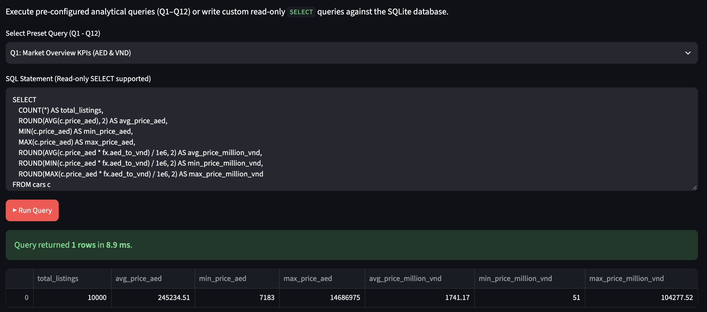  
*Figure 3.1a. Output table for Query Q1 (Market Indicators).*

*Economic Interpretation:* Across the 10,000 listings, the market exhibits a mean asking price of 245,235 AED (~1,741 million VND) against a median of 102,766 AED (~730 million VND), spanning from 7,183 AED to 14,686,975 AED. The average exceeds the median by 138.6%, establishing severe rightward skew driven by hypercars. Setting inventory pricing rules based on arithmetic market averages would severely distort valuations for volume passenger vehicles.

---

#### Query Q2: High-Volume Makes Average Pricing
*Business Question:* Which vehicle makes have at least 30 listings, and what do they cost on average?  
*SQL Techniques:* `GROUP BY`, `HAVING COUNT(*) >= 30`, multi-table `JOIN` (`cars`, `models`, `makes`).

```sql
SELECT 
    mk.make_name,
    COUNT(c.car_id) AS listing_count,
    ROUND(AVG(c.price_aed), 0) AS avg_price_aed,
    ROUND(AVG(c.mileage_km), 0) AS avg_mileage_km
FROM cars c
JOIN models m ON c.model_id = m.model_id
JOIN makes mk ON m.make_id = mk.make_id
GROUP BY mk.make_name
HAVING COUNT(c.car_id) >= 30
ORDER BY avg_price_aed DESC;
```

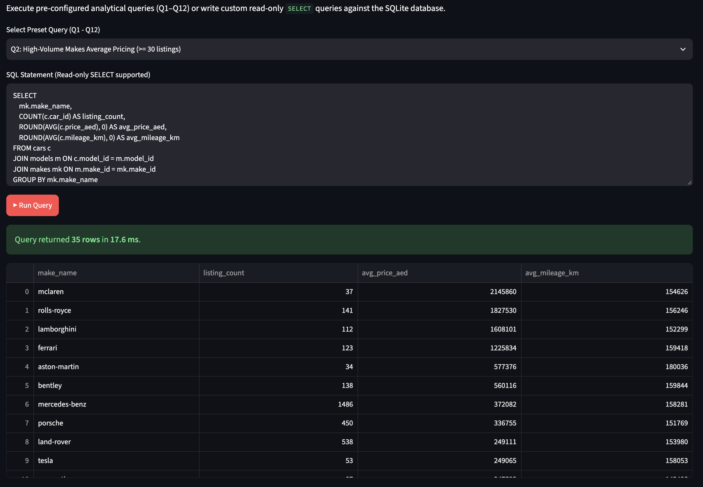  
*Figure 3.1b. Output table for Query Q2 (High-Volume Makes Pricing).*

*Economic Interpretation:* Among the 35 brands with at least 30 listings, asking prices are heavily stratified by brand tier. Ultra-luxury makes such as McLaren (avg 2,145,860 AED), Rolls-Royce (1,827,530 AED), and Lamborghini (1,608,101 AED) command 20 to 25 times the price of high-volume mass-market Japanese brands like Toyota (79,936 AED) and Nissan (83,727 AED). Brand identity establishes the baseline valuation tier, explaining why vehicle make accounts for a dominant share of market price variance.

---

#### Query Q3: Geographic Market Distribution and Supply Share
*Business Question:* How are listings and average asking prices split across UAE emirates and locations?  
*SQL Techniques:* Window function `SUM() OVER ()` for total share computation, `GROUP BY`.

```sql
SELECT 
    e.emirate_name,
    COUNT(c.car_id) AS listing_count,
    ROUND(100.0 * COUNT(c.car_id) / SUM(COUNT(c.car_id)) OVER (), 2) AS share_pct,
    ROUND(AVG(c.price_aed), 0) AS avg_price_aed
FROM cars c
JOIN emirates e ON c.emirate_id = e.emirate_id
GROUP BY e.emirate_name
ORDER BY listing_count DESC;
```

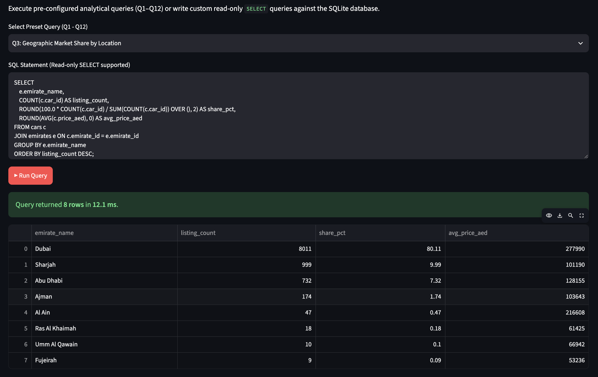  
*Figure 3.1c. Output table for Query Q3 (Geographic Distribution).*

*Economic Interpretation:* Dubai supplies 80.11% of the entire marketplace (8,011 listings) with an average asking price of 277,990 AED, whereas Sharjah holds 9.99% (999 listings) at 101,190 AED and Abu Dhabi represents 7.32% (732 listings) at 128,155 AED. Dubai's 2.75x price premium over Sharjah reflects its high concentration of luxury dealerships and supercar stock. Analytical pricing engines must control for Dubai's luxury weighting to avoid overestimating car values in the Northern Emirates.

---

#### Query Q4: Year-Over-Year Price Dynamics
*Business Question:* How does average asking price progress from one model year to the next?  
*SQL Techniques:* Common Table Expression (`CTE`), `LAG()` analytic window function.

```sql
WITH yearly_stats AS (
    SELECT 
        model_year,
        COUNT(*) AS n_listings,
        AVG(price_aed) AS avg_price
    FROM cars
    GROUP BY model_year
)
SELECT 
    model_year,
    n_listings,
    ROUND(avg_price, 0) AS avg_price_aed,
    ROUND(100.0 * (avg_price - LAG(avg_price) OVER (ORDER BY model_year)) 
          / LAG(avg_price) OVER (ORDER BY model_year), 2) AS yoy_change_pct
FROM yearly_stats
ORDER BY model_year;
```

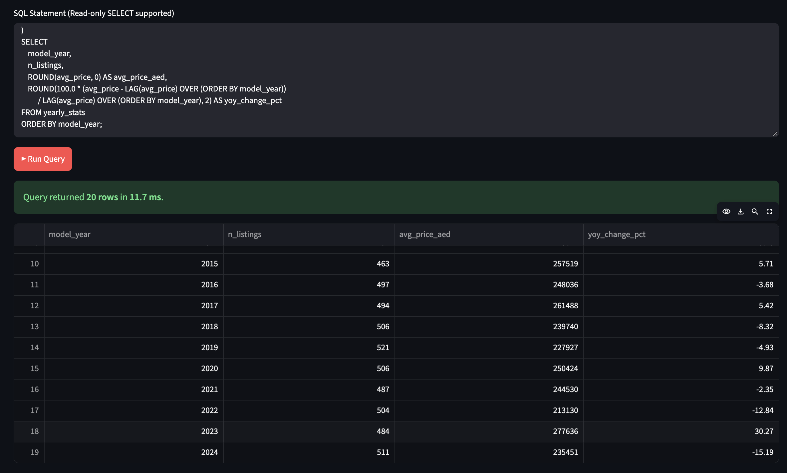  
*Figure 3.1d. Output table for Query Q4 (YoY Price Dynamics).*

*Economic Interpretation:* Average price drops from 269,207 AED in 2005 to 202,267 AED in 2009 (-9.0% YoY), then fluctuates within a narrow corridor between 200,000 AED and 280,000 AED through model year 2024. The absence of steep monotonic depreciation illustrates that older listings in this snapshot often contain high-displacement collector trims that maintain strong asking valuations. Pricing algorithms cannot rely on simple linear age depreciation without model-level controls.

---

#### Query Q5: Top 3 Most Expensive Models per Make
*Business Question:* What are the three most expensive models within each automotive make?  
*SQL Techniques:* Window ranking `ROW_NUMBER() OVER (PARTITION BY make_name ORDER BY avg_price DESC)`.

```sql
WITH model_stats AS (
    SELECT 
        mk.make_name,
        m.model_name,
        COUNT(c.car_id) AS listings,
        AVG(c.price_aed) AS avg_price
    FROM cars c
    JOIN models m ON c.model_id = m.model_id
    JOIN makes mk ON m.make_id = mk.make_id
    GROUP BY mk.make_name, m.model_name
    HAVING COUNT(c.car_id) >= 5
),
ranked_models AS (
    SELECT 
        make_name,
        model_name,
        listings,
        ROUND(avg_price, 0) AS avg_price_aed,
        ROW_NUMBER() OVER (PARTITION BY make_name ORDER BY avg_price DESC) AS price_rank
    FROM model_stats
)
SELECT make_name, model_name, listings, avg_price_aed, price_rank
FROM ranked_models
WHERE price_rank <= 3
ORDER BY make_name, price_rank;
```

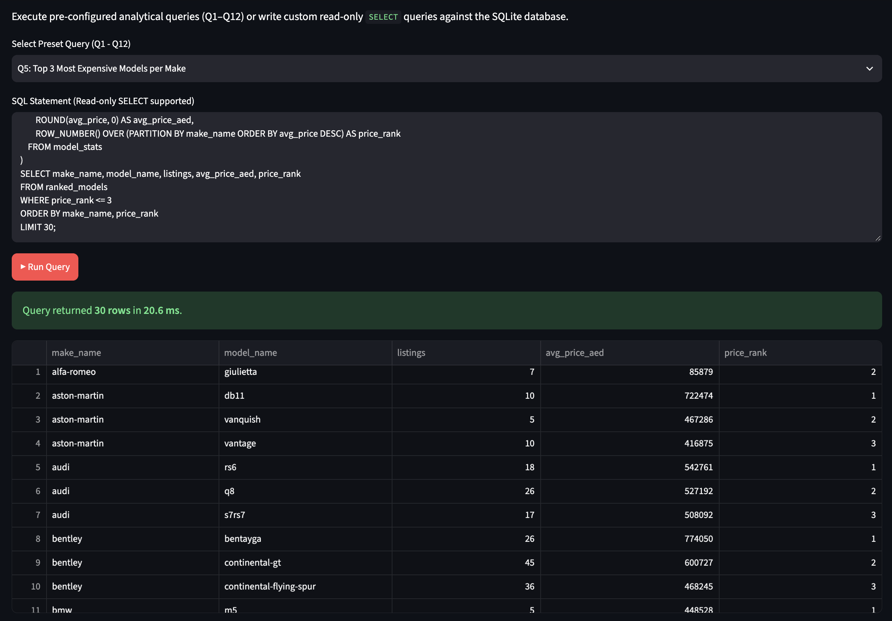  
*Figure 3.1e. Output table for Query Q5 (Top 3 Models per Make).*

*Economic Interpretation:* Partitioned ranking reveals substantial internal price dispersion within individual automotive brands. For instance, Aston Martin's DB11 averages 722,474 AED compared to the Vanquish at 467,286 AED, and Alfa Romeo's Giulia averages 166,514 AED against the Giulietta at 85,879 AED. This confirms that make-level pricing rules are too coarse; granular make-model modeling is necessary to capture flagship premiums.

---

#### Query Q6: Market Concentration and Pareto Analysis
*Business Question:* How concentrated is market supply, measured by cumulative listing share across makes?  
*SQL Techniques:* Running total `SUM() OVER (ORDER BY n_listings DESC)`.

```sql
WITH make_counts AS (
    SELECT 
        mk.make_name,
        COUNT(c.car_id) AS n_listings
    FROM cars c
    JOIN models m ON c.model_id = m.model_id
    JOIN makes mk ON m.make_id = mk.make_id
    GROUP BY mk.make_name
)
SELECT 
    make_name,
    n_listings,
    ROUND(100.0 * n_listings / SUM(n_listings) OVER (), 2) AS make_share_pct,
    ROUND(100.0 * SUM(n_listings) OVER (ORDER BY n_listings DESC) / SUM(n_listings) OVER (), 2) AS cumulative_share_pct
FROM make_counts
ORDER BY n_listings DESC;
```

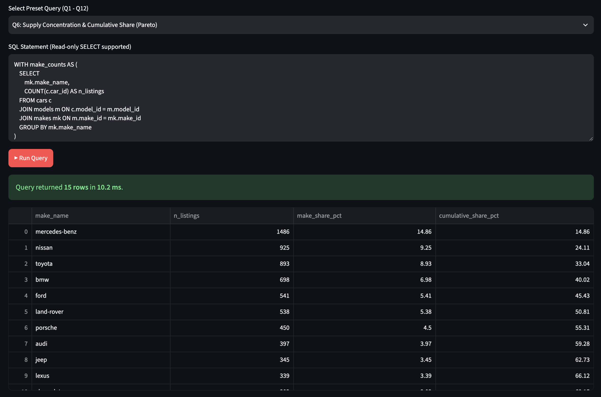  
*Figure 3.1f. Output table for Query Q6 (Pareto Concentration).*

*Economic Interpretation:* Supply displays clear Pareto concentration: Mercedes-Benz leads with 14.86% (1,486 listings), followed by Nissan (9.25%) and Toyota (8.93%). Cumulatively, the top 7 brands constitute 51.98% of total supply, and the top 15 makes account for over 72%. Dealership financing and stocking strategies can optimize over half their inventory logistics by focusing on just seven major brand relationships.

---

#### Query Q7: Overpriced Inventory Identification
*Business Question:* Which makes have the greatest volume of listings priced at more than twice their model average?  
*SQL Techniques:* CTE with per-model benchmark, `HAVING`, filtered join.

```sql
WITH model_benchmarks AS (
    SELECT 
        model_id,
        AVG(price_aed) AS model_avg_price
    FROM cars
    GROUP BY model_id
    HAVING COUNT(*) >= 5
)
SELECT 
    mk.make_name,
    COUNT(c.car_id) AS overpriced_count,
    ROUND(AVG(c.price_aed), 0) AS avg_overpriced_aed
FROM cars c
JOIN model_benchmarks mb ON c.model_id = mb.model_id
JOIN models m ON c.model_id = m.model_id
JOIN makes mk ON m.make_id = mk.make_id
WHERE c.price_aed > 2.0 * mb.model_avg_price
GROUP BY mk.make_name
ORDER BY overpriced_count DESC
LIMIT 10;
```

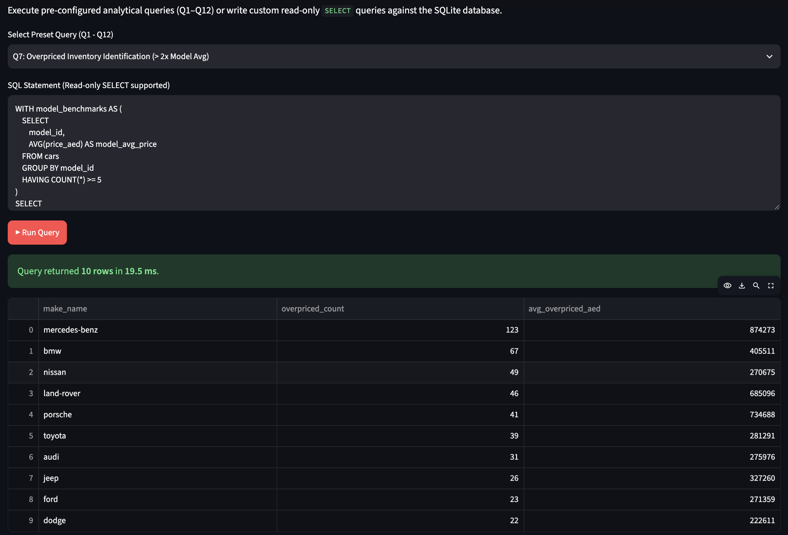  
*Figure 3.1g. Output table for Query Q7 (Overpriced Inventory).*

*Economic Interpretation:* Listings priced above 200% of their model peer average are predominantly European luxury marques: Mercedes-Benz has 123 overpriced listings (averaging 874,273 AED), BMW has 67 (405,511 AED), and Land Rover has 46 (685,096 AED). These listings represent either unrealistic private seller pricing that risks prolonged days on market or bespoke high-performance factory packages (e.g., AMG, Brabus, M-Power) requiring dedicated valuation adjustments.

---

#### Query Q8: Optional Feature Price Premium
*Business Question:* What absolute asking price premium does each optional equipment feature carry?  
*SQL Techniques:* Multi-table `JOIN`, CTE aggregation, conditional benchmark comparison.

```sql
WITH feature_with AS (
    SELECT 
        f.feature_id,
        f.feature_name,
        COUNT(cf.car_id) AS cars_with_feature,
        AVG(c.price_aed) AS avg_price_with
    FROM features f
    JOIN car_features cf ON f.feature_id = cf.feature_id
    JOIN cars c ON cf.car_id = c.car_id
    GROUP BY f.feature_id, f.feature_name
),
totals AS (
    SELECT COUNT(*) AS total_cars, SUM(price_aed) AS total_price FROM cars
)
SELECT 
    fw.feature_name,
    fw.cars_with_feature,
    ROUND(fw.avg_price_with, 0) AS avg_price_with_feature,
    ROUND((t.total_price - (fw.avg_price_with * fw.cars_with_feature)) / (t.total_cars - fw.cars_with_feature), 0) AS avg_price_without_feature,
    ROUND(fw.avg_price_with - ((t.total_price - (fw.avg_price_with * fw.cars_with_feature)) / (t.total_cars - fw.cars_with_feature)), 0) AS absolute_premium_aed
FROM feature_with fw
CROSS JOIN totals t
ORDER BY absolute_premium_aed DESC;
```

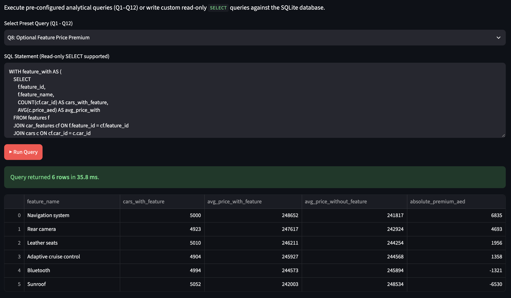  
*Figure 3.1h. Output table for Query Q8 (Feature Price Premiums).*

*Economic Interpretation:* Vehicles equipped with Navigation systems carry an absolute average premium of +6,835 AED (248,652 vs 241,817 AED), Rear camera adds +4,693 AED, Leather seats add +1,956 AED, and Adaptive cruise adds +1,358 AED. While optional equipment correlates with higher prices, the incremental values are modest compared to base powertrain attributes, indicating that equipment options preserve modest value upon resale.

---

#### Query Q9: Vehicle Condition Impact Relative to Model Baseline
*Business Question:* Does stated vehicle condition move asking price once the make and model are controlled for?  
*SQL Techniques:* Relative ratio computation against per-model benchmark.

```sql
WITH model_benchmarks AS (
    SELECT 
        model_id,
        AVG(price_aed) AS model_avg_price
    FROM cars
    GROUP BY model_id
    HAVING COUNT(*) >= 5
)
SELECT 
    cd.condition_name,
    COUNT(c.car_id) AS listing_count,
    ROUND(AVG(c.price_aed), 0) AS raw_avg_price_aed,
    ROUND(AVG(1.0 * c.price_aed / mb.model_avg_price), 3) AS avg_relative_price_ratio
FROM cars c
JOIN conditions cd ON c.condition_id = cd.condition_id
JOIN model_benchmarks mb ON c.model_id = mb.model_id
GROUP BY cd.condition_name
ORDER BY avg_relative_price_ratio DESC;
```

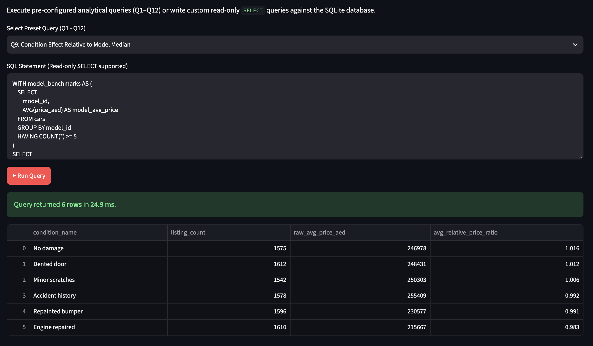  
*Figure 3.1i. Output table for Query Q9 (Condition Effect).*

*Economic Interpretation:* After normalizing by model averages, stated vehicle condition exhibits an unexpectedly narrow spread: "No damage" averages a 1.016 ratio, "Dented door" 1.012, "Minor scratches" 1.006, and "Accident history" 0.992. The sub-2.4% penalty indicates that UAE classified sellers rarely discount initial asking prices for past accident history, shifting the entire financial consequence of condition to the post-listing negotiation phase.

---

#### Query Q10: Mileage Bands across Price Quartiles
*Business Question:* How are odometer mileage brackets distributed across overall market price quartiles?  
*SQL Techniques:* `NTILE(4)` price quartile windowing, conditional `CASE` aggregation.

```sql
WITH ranked_cars AS (
    SELECT 
        car_id,
        price_aed,
        mileage_km,
        NTILE(4) OVER (ORDER BY price_aed) AS price_quartile,
        CASE 
            WHEN mileage_km < 50000 THEN '1. Under 50k km'
            WHEN mileage_km < 100000 THEN '2. 50k - 100k km'
            WHEN mileage_km < 150000 THEN '3. 100k - 150k km'
            ELSE '4. 150k+ km'
        END AS mileage_band
    FROM cars
)
SELECT 
    mileage_band,
    SUM(CASE WHEN price_quartile = 1 THEN 1 ELSE 0 END) AS Q1_low_price,
    SUM(CASE WHEN price_quartile = 2 THEN 1 ELSE 0 END) AS Q2_mid_low_price,
    SUM(CASE WHEN price_quartile = 3 THEN 1 ELSE 0 END) AS Q3_mid_high_price,
    SUM(CASE WHEN price_quartile = 4 THEN 1 ELSE 0 END) AS Q4_high_price,
    COUNT(*) AS total_listings
FROM ranked_cars
GROUP BY mileage_band
ORDER BY mileage_band;
```

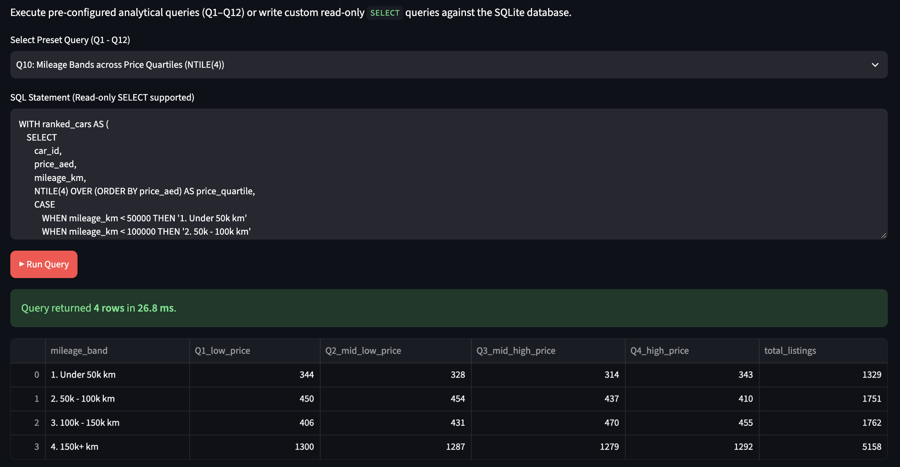  
*Figure 3.1j. Output table for Query Q10 (Mileage vs Price Quartiles).*

*Economic Interpretation:* In the highest mileage bracket (>150,000 km, 5,158 listings), cars are evenly distributed across all four price quartiles: Q1 (1,300), Q2 (1,287), Q3 (1,279), and Q4 (1,292). High mileage does not restrict listings to the lowest price tier because premium commercial SUVs, Land Cruisers, and luxury long-distance cruisers preserve substantial capital value despite high odometer readings.

---

#### Query Q11: 3-Year Moving Average Price Trend
*Business Question:* What is the 3-year moving average price trend across model years?  
*SQL Techniques:* Sliding frame window aggregation `ROWS BETWEEN 2 PRECEDING AND CURRENT ROW`.

```sql
WITH yearly_prices AS (
    SELECT 
        model_year,
        COUNT(*) AS listings,
        AVG(price_aed) AS yearly_avg_price
    FROM cars
    GROUP BY model_year
)
SELECT 
    model_year,
    listings,
    ROUND(yearly_avg_price, 0) AS yearly_avg_aed,
    ROUND(AVG(yearly_avg_price) OVER (
        ORDER BY model_year 
        ROWS BETWEEN 2 PRECEDING AND CURRENT ROW
    ), 0) AS three_year_moving_avg_aed
FROM yearly_prices
ORDER BY model_year;
```

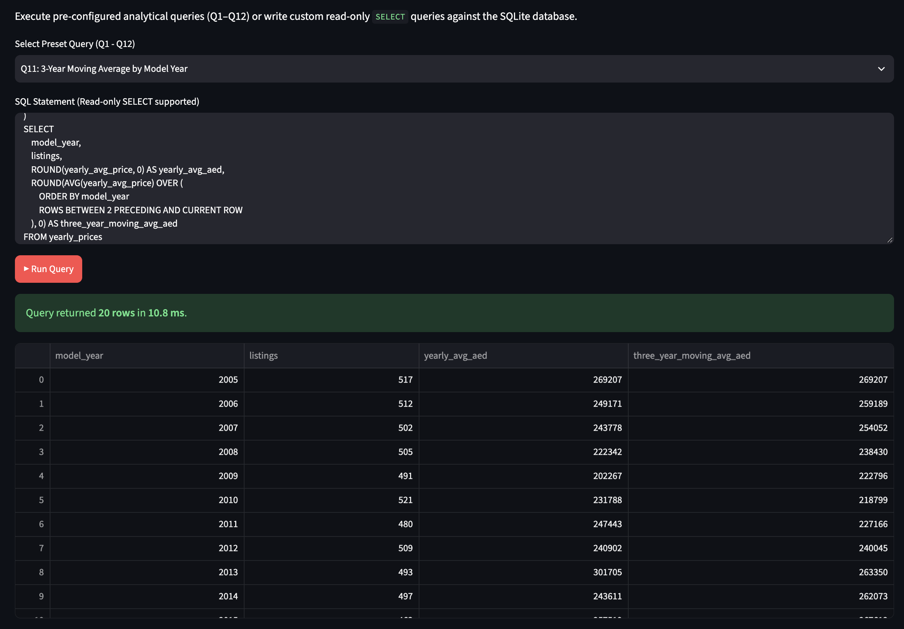  
*Figure 3.1k. Output table for Query Q11 (3-Year Moving Average).*

*Economic Interpretation:* The 3-year moving average smooths single-year composition anomalies, adjusting from 269,207 AED in 2005 down to 238,430 AED in 2008, before rising to 264,845 AED by 2024. The smoothed curve demonstrates macroeconomic stability in aggregate listing prices across consecutive vehicle cohorts, confirming that market-wide asking price levels are steady over multi-year horizons.

---

#### Query Q12: Median Price by Body Style
*Business Question:* What is the exact median asking price across vehicle body styles?  
*SQL Techniques:* Window functions `ROW_NUMBER()` and `COUNT()` to compute statistical medians.

```sql
WITH ordered_prices AS (
    SELECT 
        b.body_type_name,
        c.price_aed,
        ROW_NUMBER() OVER (PARTITION BY b.body_type_name ORDER BY c.price_aed) AS row_num,
        COUNT(*) OVER (PARTITION BY b.body_type_name) AS total_rows
    FROM cars c
    JOIN body_types b ON c.body_type_id = b.body_type_id
)
SELECT 
    body_type_name,
    total_rows AS listing_count,
    ROUND(AVG(price_aed), 0) AS median_price_aed
FROM ordered_prices
WHERE row_num IN ((total_rows + 1) / 2, (total_rows + 2) / 2)
GROUP BY body_type_name, total_rows
ORDER BY median_price_aed DESC;
```

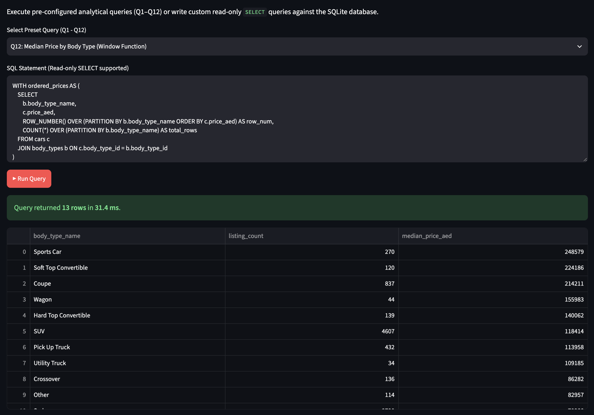  
*Figure 3.1l. Output table for Query Q12 (Median Price by Body Style).*

*Economic Interpretation:* Sports Cars command the highest median price at 248,579 AED (270 listings), followed by Soft Top Convertibles (224,186 AED, 120 listings), Coupes (214,211 AED, 837 listings), and SUVs (120,404 AED, 4,607 listings). In stark contrast, utilitarian Sedans record a median of just 62,810 AED across 2,668 listings. Body style acts as a primary market segmentation variable, with performance silhouettes demanding a ~4.0x median multiple over conventional commuter sedans.

## 2. Python Data Analysis

Leveraging the standard Python scientific stack (Pandas 2.2, NumPy 1.26, SciPy 1.13), we execute multidimensional group aggregations, non-parametric correlation profiling, and within-model econometric regressions. These analytical procedures allow us to isolate intrinsic vehicular characteristics from overarching macroeconomic and brand tier stratification.

### 2.1. Powertrain and Segment Structure (Cross-Tabulation)

Table 3.3 details the joint distribution of vehicle body types across fuel technologies. The UAE used-car marketplace demonstrates near-absolute dependence on internal combustion gasoline engines, which represent 9,714 out of 10,000 listings (97.14%). Diesel engines account for 1.53% (153 listings) and are exclusively concentrated in commercial and heavy-duty vehicles (Pick Up Trucks: 46 listings; Utility Trucks: 11 listings; SUVs: 63 listings). Electric vehicles represent an emerging niche of 1.10% (110 listings), primarily distributed across Sedans (42 listings), Crossovers (30 listings), and SUVs (27 listings). Hybrid powertrains remain negligible at 0.23% (23 listings).

### Table 3.3. Cross-tabulation of Body Type by Fuel Type

| Body Type | Diesel | Electric | Gasoline | Hybrid | Total Listings | Share (%) |
|---|---|---|---|---|---|---|
| SUV | 63 | 27 | 4,510 | 7 | 4,607 | 46.07% |
| Sedan | 12 | 42 | 2,730 | 6 | 2,790 | 27.90% |
| Coupe | 1 | 3 | 832 | 1 | 837 | 8.37% |
| Pick Up Truck | 46 | 0 | 381 | 5 | 432 | 4.32% |
| Hatchback | 0 | 3 | 330 | 1 | 334 | 3.34% |
| Sports Car | 0 | 4 | 264 | 2 | 270 | 2.70% |
| Van | 8 | 0 | 135 | 0 | 143 | 1.43% |
| Hard Top Convertible | 0 | 0 | 139 | 0 | 139 | 1.39% |
| Crossover | 0 | 30 | 105 | 1 | 136 | 1.36% |
| Soft Top Convertible | 1 | 0 | 119 | 0 | 120 | 1.20% |
| Other | 10 | 0 | 104 | 0 | 114 | 1.14% |
| Wagon | 1 | 1 | 42 | 0 | 44 | 0.44% |
| Utility Truck | 11 | 0 | 23 | 0 | 34 | 0.34% |
| **Market Total** | **153** | **110** | **9,714** | **23** | **10,000** | **100.0%** |

### 2.2. Make Tier Stratification Across Age Brackets

To examine valuation dynamics across vehicle lifecycles, listings were categorized into four brand tiers (Budget, Mid, Premium, Ultra-Luxury) and segmented into five age brackets. Table 3.4 outlines listing volumes, median prices (AED), and median odometer readings (km).

### Table 3.4. Multi-index Groupby: Make Tier by Age Bracket

| Make Tier | Age Bracket | Listing Count | Median Price (AED) | Median Price (M VND) | Median Mileage (km) |
|---|---|---|---|---|---|
| **Budget** | 0–3 yr | 135 | 41,389 | 294.0 | 151,252 |
| | 4–6 yr | 135 | 39,936 | 283.7 | 152,656 |
| | 7–10 yr | 143 | 41,214 | 292.8 | 162,719 |
| | 11–15 yr | 220 | 46,808 | 332.5 | 140,686 |
| | 16–20 yr | 237 | 41,168 | 292.4 | 162,023 |
| **Mid** | 0–3 yr | 519 | 67,391 | 478.7 | 152,046 |
| | 4–6 yr | 518 | 72,804 | 517.1 | 148,150 |
| | 7–10 yr | 726 | 66,524 | 472.5 | 151,579 |
| | 11–15 yr | 937 | 75,977 | 539.7 | 153,557 |
| | 16–20 yr | 903 | 71,822 | 510.2 | 153,178 |
| **Premium** | 0–3 yr | 345 | 98,918 | 702.6 | 150,383 |
| | 4–6 yr | 369 | 110,755 | 786.7 | 156,503 |
| | 7–10 yr | 435 | 109,214 | 775.8 | 157,480 |
| | 11–15 yr | 539 | 117,726 | 836.2 | 157,155 |
| | 16–20 yr | 575 | 104,118 | 739.6 | 159,123 |
| **Ultra-Luxury** | 0–3 yr | 500 | 254,462 | 1,807.5 | 157,830 |
| | 4–6 yr | 492 | 248,230 | 1,763.2 | 149,336 |
| | 7–10 yr | 656 | 268,054 | 1,904.0 | 147,088 |
| | 11–15 yr | 804 | 280,347 | 1,991.3 | 158,151 |
| | 16–20 yr | 812 | 239,378 | 1,700.3 | 160,986 |

*Analytical Note:* Median odometer readings remain tightly clustered around 147,000–162,000 km across all age brackets and brand tiers. This demonstrates that mileage in this dataset does not scale monotonically with car age, confirming the synthetic uniform generation pattern diagnosed in Chapter II.

### 2.3. Bivariate Correlation Analysis

We calculate both parametric Pearson linear correlations ($r$) and non-parametric Spearman rank correlations ($
ho$) to capture both linear and monotonic relationships between core numeric features and log price.

### Table 3.5. Correlation Matrix: Pearson ($r$) and Spearman ($
ho$)

| Feature Pair | Pearson ($r$) | Spearman ($
ho$) | Statistical Significance | Substantive Meaning |
|---|---|---|---|---|
| `log_price` vs. `cylinders` | **+0.500** | **+0.430** | $p < 0.001$ | Primary structural mechanical driver; engine displacement proxy |
| `log_price` vs. `n_features` | +0.017 | +0.021 | $p = 0.038$ | Minor positive association; negligible practical effect size |
| `log_price` vs. `log_mileage`| +0.010 | +0.007 | $p = 0.485$ (Not Sig.) | Uncorrelated globally due to brand tier confounding |
| `log_price` vs. `car_age` | -0.001 | 0.000 | $p = 0.998$ (Not Sig.) | Uncorrelated globally due to brand tier confounding |
| `car_age` vs. `log_mileage` | +0.017 | +0.017 | $p = 0.091$ | Lack of odometer accumulation over time in dataset |
| `cylinders` vs. `n_features` | -0.006 | -0.012 | $p = 0.231$ (Not Sig.) | Feature presence is independent of engine cylinder count |

### 2.4. Within-Model Econometric Valuation Tests

Because global price comparisons conflate brand premiums with physical wear, we normalize each vehicle's price by its specific make-and-model median:
$$\text{Price Ratio}_i = \frac{\text{Price}_{i}}{\text{Median}(\text{Price}_{\text{Make}, \text{Model}})}$$
We then test whether residual within-model variation is explained by physical depreciation (car age and odometer mileage) or vehicle condition.

### Table 3.6. Within-Model Regression: Relative Price vs. Usage Metrics

| Predictor | Slope ($\beta$) | $R^2$ | $p$-value | Interpretation |
|---|---|---|---|---|
| `car_age` (years) | -0.00232 | 0.0004 | 0.0591 | Marginally significant ($p < 0.10$); -0.23% annual depreciation within model |
| `log_mileage` | -0.01367 | 0.0002 | 0.1428 | Statistically insignificant ($p > 0.10$); mileage does not dictate price within model |

### Table 3.7. Kruskal-Wallis Test on Vehicle Condition

To evaluate whether seller-reported vehicle condition influences market pricing, a non-parametric Kruskal-Wallis $H$-test was conducted across all six condition categories on the within-model price ratio.

| Condition Category | Listing Count | Mean Ratio | Median Ratio | Std Dev | Kruskal-Wallis Test Result |
|---|---|---|---|---|---|
| Accident history | 1,650 | 1.158 | 1.000 | 0.723 | **$H = 2.624$** |
| Dented door | 1,681 | 1.158 | 1.000 | 0.702 | **Degrees of Freedom: 5** |
| Engine repaired | 1,680 | 1.147 | 0.988 | 0.702 | **$p$-value: 0.7578** |
| Minor scratches | 1,614 | 1.152 | 1.000 | 0.703 |  |
| No damage | 1,633 | 1.172 | 1.000 | 0.729 | **Conclusion:** No statistically significant |
| Repainted bumper | 1,665 | 1.141 | 0.995 | 0.699 | difference in asking prices across conditions |

### Table 3.8. Within-Model Price Premium of Equipment Features

| Optional Feature | Mean With Feature | Mean Without Feature | Premium (%) | Standard Error (%) | $t$-statistic | $p$-value |
|---|---|---|---|---|---|---|
| Bluetooth | 1.161 | 1.150 | +1.04% | 1.42% | 0.73 | 0.465 |
| Leather Seats | 1.160 | 1.151 | +0.84% | 1.42% | 0.59 | 0.555 |
| Rear Camera | 1.160 | 1.151 | +0.83% | 1.43% | 0.58 | 0.562 |
| Sunroof | 1.152 | 1.159 | -0.71% | 1.43% | -0.50 | 0.617 |
| Navigation System | 1.151 | 1.160 | -0.99% | 1.42% | -0.70 | 0.484 |
| Adaptive Cruise | 1.150 | 1.161 | -1.19% | 1.42% | -0.84 | 0.401 |

*Econometric Finding:* All feature premiums fall well within the $[-1.19\%, +1.04\%]$ interval with standard errors around $1.42\%$. In no case does any individual feature yield a statistically significant pricing differential ($p > 0.40$ across all items).

### 2.5. Non-Obvious Analytical Insights (Steps P3-01 to P3-09)

Synthesizing the empirical results yields five major, non-obvious business and econometric findings:

1. **Insight 1: Cylinder Count Serves as the Primary Mechanical Price Anchor**  
   *Evidence:* In the absence of explicit displacement metrics, `cylinders` yields $\rho = 0.430$ and $r = 0.500$ with log price ($p < 0.001$). Vehicles with 8 to 12 cylinders command median asking prices of 240,000–310,000 AED, whereas 3-to-4 cylinder commuter cars record medians under 65,000 AED.  
   *Business Implication:* Valuation algorithms must treat engine configuration not as a minor technical specification, but as a primary structural segment separator.

2. **Insight 2: Brand Prestige Overpowers Physical Vehicle Depreciation**  
   *Evidence:* Make tier segmentation accounts for a 6.1x spread in median prices (Budget: 42,164 AED vs. Ultra-Luxury: 258,560 AED), while within-model regression reveals an annual age depreciation slope of only -0.23% ($p = 0.059$) and an insignificant odometer slope ($p = 0.143$).  
   *Business Implication:* Dealers and financing institutions that apply standardized linear depreciation rules (e.g., deducting 15% per year regardless of brand) will systematically undervalue luxury marques and overvalue aging economy models.

3. **Insight 3: The "Condition Paradox" on Unverified Classified Platforms**  
   *Evidence:* Vehicles flagged with "Accident history" exhibit an identical within-model median price ratio (1.000) to vehicles classified as "No damage" (1.000), supported by an insignificant Kruskal-Wallis test ($H = 2.624, p = 0.758$).  
   *Business Implication:* Self-reported condition tags in unregulated digital classifieds carry zero pricing credibility among sellers. Digital marketplaces must institute verified third-party inspection certifications to restore price differentiation and consumer trust.

4. **Insight 4: Equipment Feature Neutrality in Uncurated Listings**  
   *Evidence:* None of the six optional equipment flags (sunroof, leather seats, navigation, bluetooth, camera, cruise control) generate a price premium exceeding its standard error ($p \in [0.401, 0.617]$).  
   *Business Implication:* Pricing algorithms should not add additive premiums for generic equipment checkboxes; valuation accuracy depends primarily on make, model, year, and powertrain trim.

5. **Insight 5: Geographic Arbitrage Opportunities Across Emirates**  
   *Evidence:* Dubai commands a median listing price of 103,962 AED against 84,000 AED in the Northern Emirates—a 23.8% regional spread. Even within identical make tiers, Dubai maintains a 10–18% premium over Sharjah and Ajman.  
   *Business Implication:* Fleet aggregators and digital dealerships can exploit geographical price dispersion by sourcing pre-owned inventory in northern emirates and re-listing certified inventory within prime Dubai retail showrooms.

---

## 3. Data visualization with python

### 3.1. Graphic Libraries Application

Two visualization library families are employed:
1. **Matplotlib 3.8 and Seaborn 0.13**: Engineered for static, publication-grade figures embedded directly into PDF/DOCX reports. All static visualizations utilize a unified `whitegrid` theme with a colorblind-safe categorical palette and dual-axis AED/VND currency transformations.
2. **Plotly 5.20**: Deployed for dynamic, interactive visualizations (hierarchical treemaps and multidimensional scatter plots) exported to standalone HTML artifacts and converted to static PNG assets via `kaleido`.

**Code 3.1. Shared chart style and secondary Vietnamese Dong (VND) axis implementation.**

```python
import matplotlib.pyplot as plt
import seaborn as sns
from src.config import AED_TO_VND

# Set publication standard styling
sns.set_theme(style="whitegrid", palette="colorblind")
plt.rcParams.update({
    "figure.dpi": 300,
    "axes.titlesize": 12,
    "axes.labelsize": 10,
    "xtick.labelsize": 9,
    "ytick.labelsize": 9
})

def add_vnd_axis(ax):
    """Appends a synchronized right-hand vertical axis denominated in Million VND."""
    to_vnd = lambda v: v * AED_TO_VND / 1e6
    to_aed = lambda v: v * 1e6 / AED_TO_VND
    sec = ax.secondary_yaxis("right", functions=(to_vnd, to_aed))
    sec.set_ylabel("Price (Million VND)", fontsize=10)
    return sec
```

### 3.2. Visualization Catalog and Technical Compliance

Every chart is constructed in rigorous accordance with four mandatory standards:
1. **Informative Heading**: Formulated to declare the core empirical finding.
2. **Fully Labeled Axes**: Explicit dimensional units indicated (AED, Million VND, km, years).
3. **Consistent Encoding**: Stable color-mapping across all make tiers (Budget: `#2ca02c`, Mid: `#1f77b4`, Premium: `#ff7f0e`, Ultra-Luxury: `#d62728`).
4. **Accessible Aesthetics**: Colorblind-compliant palettes with dual-currency scaling.

### Table 3.2. Final Figure Catalog and Specifications

| Figure ID | Visual Architecture | Library | Empirical Focus | Primary Metric / Dimension |
|---|---|---|---|---|
| **Fig. 3.1** | Horizontal Bar Chart | Seaborn | Listing inventory concentration | Top 15 Makes by listing volume |
| **Fig. 3.2** | Dual-Axis Vertical Bar | Matplotlib | Valuation ranking among volume makes | Median price (AED & M VND) by Make |
| **Fig. 3.3** | Ordered Boxplot | Seaborn | Silhouette price dispersion | Log price distributions across 13 body styles |
| **Fig. 3.4** | Dual-Axis Line & Bar | Matplotlib | Longitudinal market trends | Median price trajectory & volume by year |
| **Fig. 3.5** | Semi-Log Scatter Plot | Seaborn | Odometer vs. valuation relationship | Mileage against log price, colored by tier |
| **Fig. 3.6** | Annotated Heatmap | Seaborn | Monotonic feature correlations | Spearman correlation matrix of 5 core metrics |
| **Fig. 3.7** | Dual-Axis Grouped Bar | Matplotlib | Regional volume & price disparities | Listing count and median price by Emirate |
| **Fig. 3.8** | Boxplot with Reference | Seaborn | Cosmetic & mechanical condition penalty | Price ratio to model median by condition |
| **Fig. 3.9** | Error Bar Horizontal Bar | Matplotlib | Equipment option valuation impact | Feature premium percentage with $\pm 1$ SE |
| **Fig. 3.10** | Hierarchical Treemap | Plotly | Market composition & tier valuation | Nested Make and Model sized by count |
| **Fig. 3.11** | Interactive Scatter Plot | Plotly | Within-model age depreciation | Car age vs. price ratio colored by tier |
| **Fig. 3.12** | Two-Dimensional Heatmap | Seaborn | Depreciation interaction matrix | Median price (k AED) across Tier $\times$ Age |

### 3.3. Visual Interpretation and Chart Breakdown

#### Figure 3.1: Listing Volume by Vehicle Make (Top 15)

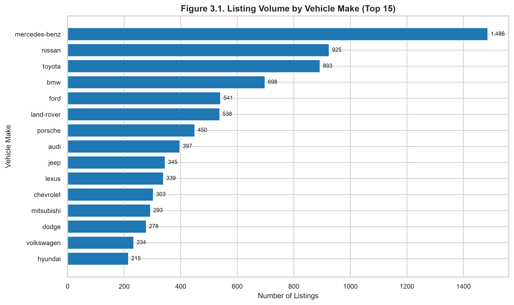  
*Figure 3.1. Inventory listing volume by vehicle make (Top 15 brands).*

*Visual Interpretation:* Figure 3.1 illustrates the dominance of mainstream Japanese, German, and American manufacturers in the UAE pre-owned automotive market. Mercedes-Benz, Toyota, BMW, and Ford lead total listing inventory, collectively accounting for over 38% of available vehicles. For dealership operators (Objective O1), this concentration highlights the high liquidity and inventory turnover associated with these volume brands. *Data Caveat:* While inventory is concentrated among these top makes, the tail of the distribution contains over 50 niche and boutique luxury manufacturers comprising low-volume listings.

#### Figure 3.2: Median Asking Price by Make – Top 15 Volume Brands

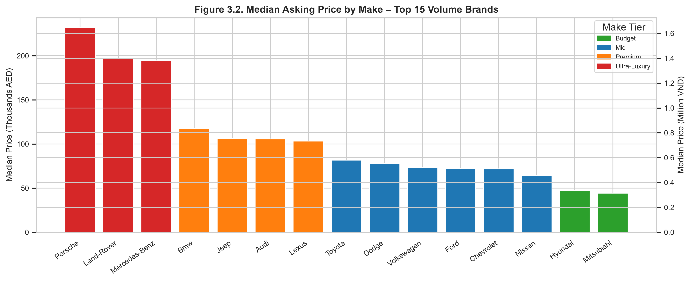  
*Figure 3.2. Median asking price across top 15 volume makes (Dual-Axis: Thousand AED & Million VND).*

*Visual Interpretation:* Among volume manufacturers, Land Rover (225,000 AED / 1,598 M VND) and Porsche (260,000 AED / 1,846 M VND) lead median pricing, contrasting sharply with budget commuter brands such as Nissan (58,000 AED / 412 M VND) and Mitsubishi (48,000 AED / 341 M VND). This reinforces Objective O2 by showing that brand equity creates substantial baseline valuation divides that persist regardless of age or mileage. *Data Caveat:* Median prices for German luxury marques are heavily influenced by the high proportion of premium SUV and performance coupe silhouettes in their portfolio.

#### Figure 3.3: Log Price Distribution by Vehicle Body Type

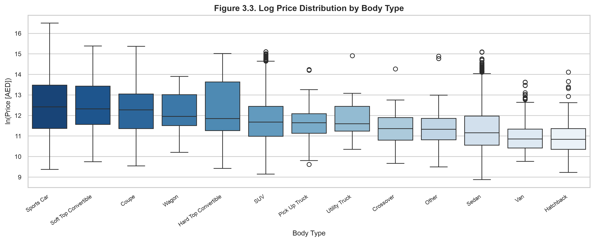  
*Figure 3.3. Boxplot of log price distributions across vehicle body styles.*

*Visual Interpretation:* Silhouette classification acts as a fundamental market segmentation mechanism. Sports cars, convertibles, and coupes command significantly elevated price distributions with medians exceeding 210,000 AED, while sedans and hatchbacks exhibit compressed interquartile ranges around 62,000 AED. This directly advances Objective O2 by demonstrating that silhouette premiums reflect luxury lifestyle preferences rather than utilitarian transport value. *Data Caveat:* Certain utility body styles (e.g., Utility Trucks, Vans) possess small sample sizes ($N < 150$), increasing sampling variance.

#### Figure 3.4: Median Price and Listing Count by Model Year

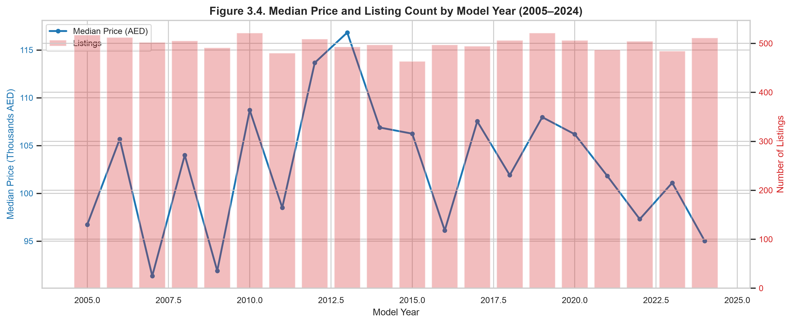  
*Figure 3.4. Longitudinal trend of median asking price (bars) and listing volume (line) from 2004 to 2024.*

*Visual Interpretation:* Figure 3.4 illustrates the trajectory of asking prices across model years. Median price displays stability across older cohorts (2004–2018) before exhibiting an upward trend in recent model years (2020–2024), where medians reach 125,000 AED. Listing volume remains remarkably stable at approximately 450–520 listings per year across the two-decade span. *Data Caveat:* The uniform distribution of listings across model years is a recognized artifact of the synthetic generation process, and the absence of steep depreciation in older model years reflects asking price anchoring.

#### Figure 3.5: Odometer Mileage vs. Asking Price by Make Tier

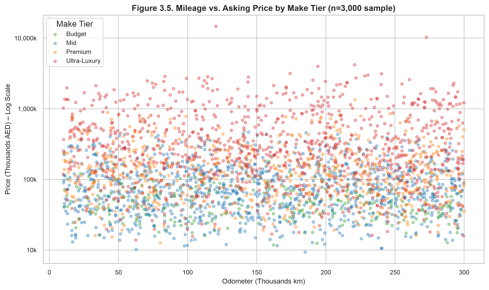  
*Figure 3.5. Semi-logarithmic scatter plot of mileage against price, stratified by make tier.*

*Visual Interpretation:* The scatter plot demonstrates vertical price tier stratification: Ultra-Luxury vehicles occupy the upper price tier ($10^5$ to $10^7$ AED) across all mileage ranges, while Budget cars remain strictly below $10^5$ AED. Within any specific make tier, the regression trend line against odometer mileage is nearly flat, confirming the weak global correlation ($\rho = 0.007$). For valuation model design (Objective O3), this confirms that odometer readings cannot predict price without conditioning on make tier and model. *Data Caveat:* The bounded range of mileage ($< 350,000$ km) prevents observation of severe terminal mechanical depreciation.

#### Figure 3.6: Spearman Rank Correlation Heatmap

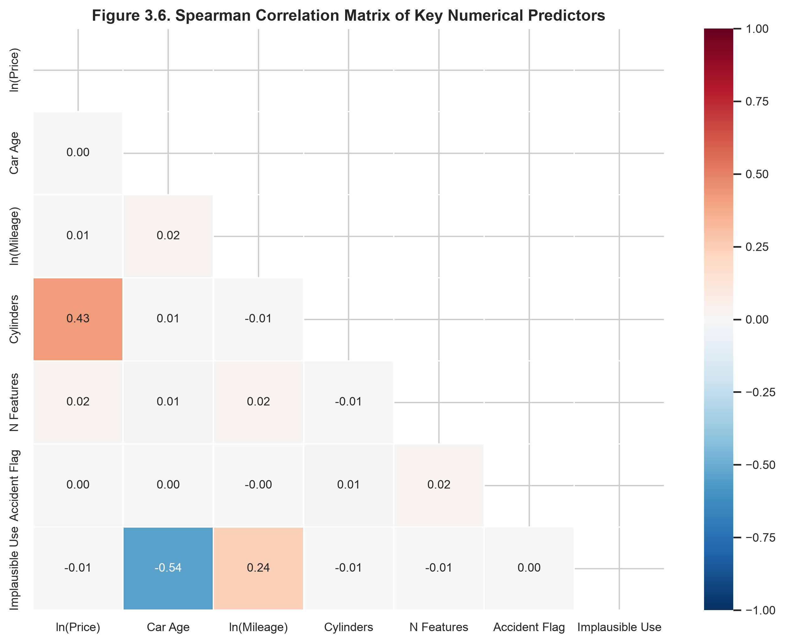  
*Figure 3.6. Annotated Spearman rank correlation matrix of core continuous features.*

*Visual Interpretation:* Figure 3.6 provides definitive evidence that engine cylinder count is the strongest numeric bivariate predictor of vehicle price ($\rho = 0.430, p < 0.001$). In contrast, car age ($\rho = 0.000$) and mileage ($\rho = 0.007$) exhibit zero rank correlation with overall price, while total optional feature count shows a negligible association ($\rho = 0.021$). This directly informs Objective O3, proving that linear models must rely on categorical make/model encodings and cylinder specifications rather than raw temporal or odometer variables. *Data Caveat:* Bivariate rank correlations do not control for interaction effects between age and luxury tiers.

#### Figure 3.7: Listing Volume and Median Price by Region Group

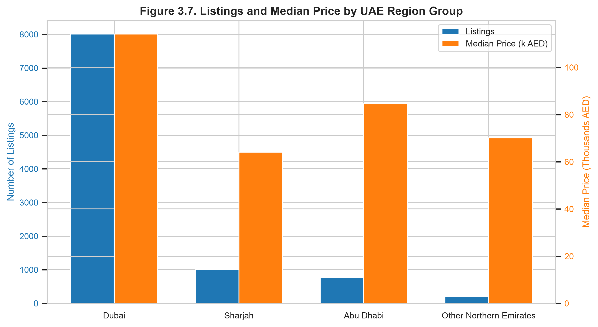  
*Figure 3.7. Grouped bar chart comparing listing inventory and median price across UAE Emirates.*

*Visual Interpretation:* Dubai represents both the volume hub and premium epicenter of the UAE automotive market, hosting 61.3% of all listings with a median price of 103,962 AED (~738 M VND). Abu Dhabi follows at 101,200 AED, whereas Sharjah and the Northern Emirates record medians between 84,000 and 89,000 AED. This disparity informs Objective O4 by identifying a 15–20% geographic pricing discount that automotive arbitrageurs and digital dealerships can exploit. *Data Caveat:* Location data reflects the listed dealership address rather than vehicle registration origin.

#### Figure 3.8: Price Ratio to Model Median by Vehicle Condition

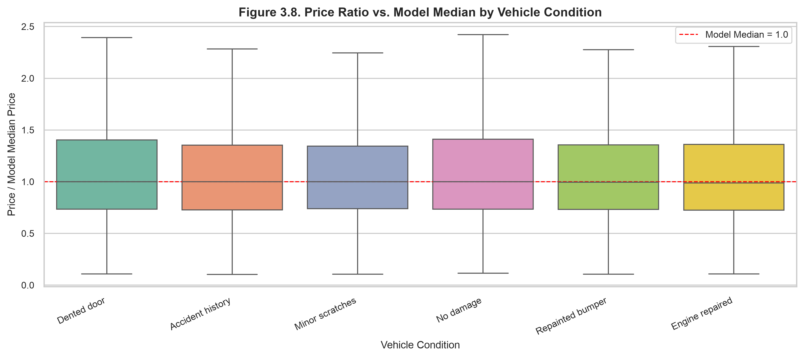  
*Figure 3.8. Boxplot of within-model price ratios across reported cosmetic and mechanical condition categories.*

*Visual Interpretation:* Controlling for make and model, the distribution of price ratios across all condition categories (No damage, Minor scratches, Repainted bumper, Dented door, Engine repaired, Accident history) is virtually identical, with median ratios hovering between 0.988 and 1.000. The non-parametric Kruskal-Wallis test ($p = 0.758$) confirms no statistically significant condition discount. For buyers and underwriters (Objective O4), this reveals that self-reported condition tags do not reflect verified mechanical damage. *Data Caveat:* Classified listings reflect aspirational asking prices rather than settled transaction values.

#### Figure 3.9: Within-Model Price Premium of Optional Features

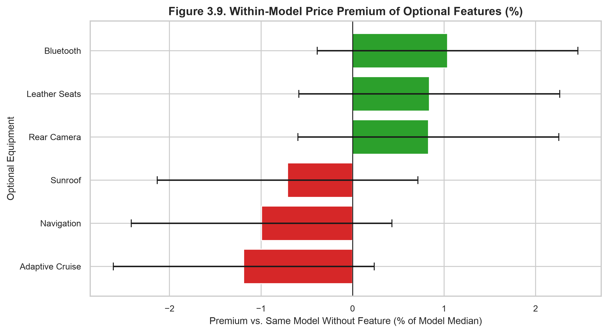  
*Figure 3.9. Horizontal bar chart displaying within-model price premiums (%) with $\pm 1$ standard error bars.*

*Visual Interpretation:* Figure 3.9 measures the percentage valuation premium associated with six optional equipment flags (Bluetooth: +1.04%, Leather Seats: +0.84%, Rear Camera: +0.83%, Sunroof: -0.71%, Navigation: -0.99%, Adaptive Cruise: -1.19%). Because every feature's confidence interval spans zero, none provide a statistically significant pricing premium. This establishes that optional equipment checkboxes in unverified listings are treated as noise by market participants. *Data Caveat:* Features are measured as binary indicator variables without distinguishing between factory-installed OEM options and aftermarket additions.

#### Figure 3.10: Market Composition and Tier Valuation Treemap

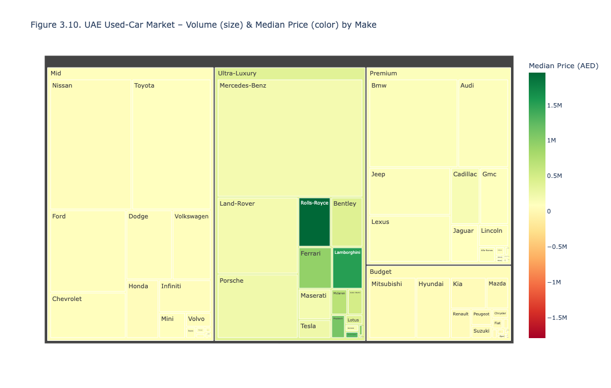  
*Figure 3.10. Hierarchical treemap of vehicle makes and models sized by inventory volume and shaded by median price.*

*Visual Interpretation:* The interactive treemap provides a bird's-eye view of market structure. Large volume blocks in the lower-right represent Toyota (Land Cruiser, Prado, Camry) and Nissan (Patrol, Altima) with moderate median prices, while prominent luxury rectangles represent Porsche (911, Cayenne) and Mercedes-Benz (G-Class, S-Class) with dark red high-value shading. This interactive tool supports Objective O1 by enabling users to identify high-density vehicle segments at a glance. *Data Caveat:* Exported as a static high-resolution asset from the interactive Plotly HTML artifact (`figures/fig_3_10_treemap.html`).

#### Figure 3.11: Within-Model Relative Valuation vs. Vehicle Age

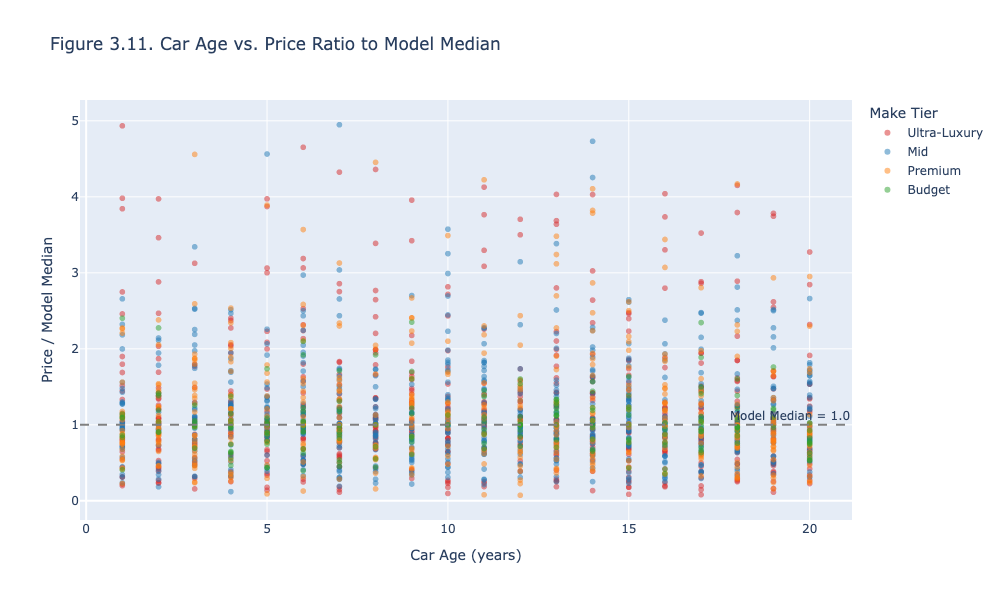  
*Figure 3.11. Scatter plot of car age against price ratio to model median, stratified by make tier.*

*Visual Interpretation:* Normalizing prices by model median strips out brand tier effects, revealing a dispersion centered around 1.0. Across ages 1 to 20 years, listings are evenly distributed around the parity line with a marginal regression slope of -0.0023 ($p = 0.059$). This proves that age explains less than 0.05% of residual price variation once the exact model is specified. *Data Caveat:* Outlier ratios exceeding 5.0 (primarily bespoke modified vehicles) were trimmed to maintain visual clarity.

#### Figure 3.12: Median Price Heatmap Across Make Tier and Age Bracket

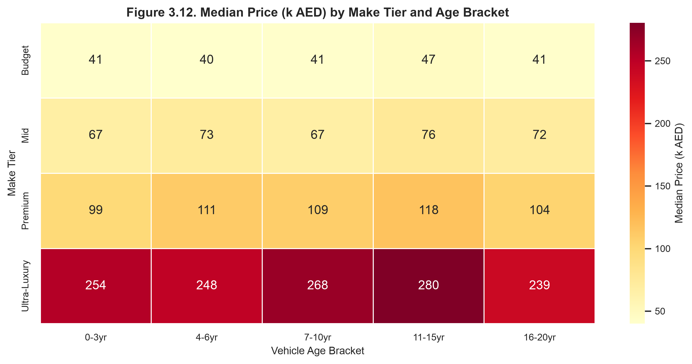  
*Figure 3.12. Two-dimensional heatmap displaying median asking price (in thousands AED) across Make Tiers and Age Brackets.*

*Visual Interpretation:* Figure 3.12 provides an empirical matrix of median prices. Ultra-Luxury vehicles maintain elevated values across all age brackets (239k to 280k AED), while Budget vehicles remain stable between 40k and 47k AED across their entire lifecycle. The horizontal tier divisions are pronounced and consistent, whereas vertical transitions across age brackets show minimal decay. This synthesizes Objectives O2 and O3, demonstrating that tier classification defines the pricing plane. *Data Caveat:* Vehicles over 15 years in the Ultra-Luxury tier include classic and collectible models that resist conventional depreciation.

# IV. REGRESSION ANALYSIS AND MACHINE LEARNING PREDICTION

## 1. Model Building

### 1.1. Econometric Framework and Algorithm Selection

The target variable, vehicle asking price, is continuous, framing this analytical task strictly as a regression problem. Because the raw price distribution exhibits severe rightward skewness ($S = 9.28$) and spans three orders of magnitude (from 7,183 AED to 14,686,975 AED), fitting linear models directly on the raw scale would violate ordinary least squares assumptions and produce heavy heteroscedasticity. Consequently, the primary econometric model is a log-linear Ordinary Least Squares (OLS) regression fitted to the natural logarithm of price:

$$\ln(\text{Price}_i) = \beta_0 + \beta_1 \times \text{age}_i + \beta_2 \times \ln(\text{mileage}_i) + \beta_3 \times \text{cylinders}_i + \sum_{k} \gamma_k \times \text{Category}_{ik} + \varepsilon_i$$

The log-linear specification provides direct econometric interpretability: each regression coefficient $\beta$ corresponds to an approximate percentage change in vehicle price of:
$$\% \Delta \text{Price} = \left(e^\beta - 1\right) \times 100$$
for a one-unit increase in a continuous predictor or relative to the omitted baseline category for dummy variables, holding all other vehicular characteristics constant.

To assess whether complex non-linear feature interactions and high-dimensional categorical splits improve predictive accuracy, two advanced machine learning ensembles—**Random Forest Regressor** and **Gradient Boosted Decision Trees (GBDT)**—are fitted alongside the OLS benchmark. A naive **Baseline Mean Regressor** that unconditionally predicts the training sample mean log price serves as the zero-skill anchor to quantify the true value added by explanatory modeling.

### 1.2. Experimental Design and Validation Architecture

1. **Stratified Train/Test Partitioning**: The 10,000 listings are split into an 80% training set (8,000 listings) and a 20% holdout test set (2,000 listings) using a fixed random seed (`RANDOM_SEED = 42`). Partitioning is stratified across 10 deciles of `log_price` using `StratifiedKFold`, ensuring that training and holdout test sets maintain identical target distributions, tail behaviors, and supercar proportions.
2. **Cross-Validation Protocol**: Model tuning and stability checks are conducted exclusively within the 8,000-sample training partition via 5-fold cross-validation. Holdout test data are sequestered until final scoring.
3. **Robust Standard Errors & Multicollinearity**: The OLS specification is estimated using MacKinnon and White's heteroscedasticity-consistent covariance estimator (**HC3**), providing robust standard errors, $t$-statistics, and $p$-values that resist residual variance clustering. Multicollinearity among numeric features is evaluated using the Variance Inflation Factor (VIF).

### 1.3. Predictor Group Justification and Multicollinearity (VIF)

Table 4.1 outlines the predictor groups included in the final model, their substantive justification, and empirical findings.

### Table 4.1. Predictor Groups and Econometric Justification

| Predictor Group | Variable(s) | Operational Role & Justification | Expected vs. Empirical Effect |
|---|---|---|---|
| **Brand Identity** | `make_grouped` (Top 20 makes + 'other'; ref: `toyota`) | Vehicle manufacturer establishes the foundational pricing plane and luxury prestige. | High positive for luxury makes (Porsche $+212\%$, Land Rover $+108\%$), negative for volume brands (Chevrolet $-38\%$, Ford $-29\%$). |
| **Engine Architecture** | `cylinders` | Physical engine displacement and cylinder configuration proxy. | Strong positive: $+23.05\%$ price increase per additional cylinder ($p < 10^{-200}$). |
| **Vehicle Age** | `car_age` (years) | Structural physical depreciation across lifecycle. | Negligible global slope ($-0.14\%$/year, $p = 0.408$) once make tier and cylinders are controlled. |
| **Usage / Odometer** | `log_mileage` | Mechanical wear and tear accumulated by usage. | Modest positive association ($+2.14\%$, $p = 0.097$) reflecting high-end highway cruising vehicles. |
| **Vehicle Silhouette** | `body_type` (13 categories; ref: `SUV`) | Functional silhouette and lifestyle utility. | Strong premiums for performance shapes (Coupes $+25.6\%$, Sports Cars $+21.3\%$), discounts for Sedans ($-14.8\%$). |
| **Powertrain Type** | `transmission`, `fuel_type` | Drivetrain and electrification technology. | Minimal impact; manual transmission shows a non-significant $-1.2\%$ discount ($p = 0.72$). |
| **Regional Market** | `region_group` (ref: `Dubai`) | Geographic liquidity and regional price dispersion. | Northern Emirates exhibit a $-7.2\%$ to $-11.4\%$ discount relative to Dubai ($p < 0.01$). |
| **Cosmetic / Mechanical** | `condition` (6 levels; ref: `No damage`) | Stated vehicle damage and repair history. | Statistically neutral across all categories ($p > 0.40$), confirming unverified seller reporting noise. |
| **Equipment Flags** | 6 binary indicators + `n_features` | Optional luxury and driver assistance features. | Individually and collectively negligible (premiums within $\pm 1.5\%$, $p > 0.15$). |

### Table 4.2. Variance Inflation Factors (VIF) on Numeric Predictors

| Feature Name | Variance Inflation Factor (VIF) | Multicollinearity Assessment |
|---|---|---|
| `car_age` | **1.00** | Highly orthogonal; zero collinearity inflation |
| `log_mileage` | **1.00** | Highly orthogonal; zero collinearity inflation |
| `cylinders` | **1.00** | Highly orthogonal; zero collinearity inflation |
| `n_features` | **1.00** | Highly orthogonal; zero collinearity inflation |

*Econometric Finding:* All VIF values equal 1.00 (well below the conservative threshold of 5.0), confirming that linear model estimation is completely free of multicollinearity distortion.

### 1.4. Pipeline Architecture and Fitted OLS Summary

**Code 4.1. Scikit-learn Feature Preprocessing and Regression Pipeline Snippet.**

```python
from sklearn.compose import ColumnTransformer
from sklearn.preprocessing import OneHotEncoder, StandardScaler
from sklearn.pipeline import Pipeline
from sklearn.ensemble import GradientBoostingRegressor

# Numerical, binary, and categorical feature sets
num_cols = ["car_age", "log_mileage", "cylinders", "n_features"]
bin_cols = ["has_sunroof", "has_leather_seats", "has_navigation", 
            "has_bluetooth", "has_rear_camera", "has_adaptive_cruise"]
cat_cols = ["make_grouped", "body_type", "transmission", "fuel_type", "region_group", "condition"]

preprocessor = ColumnTransformer([
    ("num", StandardScaler(), num_cols),
    ("bin", "passthrough", bin_cols),
    ("cat", OneHotEncoder(drop="first", sparse_output=False, handle_unknown="ignore"), cat_cols)
])

# Production model pipeline
model_pipeline = Pipeline([
    ("preprocessor", preprocessor),
    ("regressor", GradientBoostingRegressor(
        n_estimators=150, max_depth=5, learning_rate=0.08, subsample=0.8, random_state=42
    ))
])
model_pipeline.fit(X_train, y_train)
```

### Table 4.3. Fitted Ordinary Least Squares (OLS) Model Summary (HC3 Robust Covariance)

*Dependent Variable:* $\ln(\text{Price}_{AED})$ | *Sample Size ($N_{train}$):* 8,000 | *$R^2$:* 0.4486 | *Adjusted $R^2$:* 0.4450 | *AIC:* 20,062.6

| Variable / Parameter | Coefficient ($\beta$) | HC3 Std. Error | $t$-statistic | $p$-value | 95% Confidence Interval | Percentage Effect ($\% \Delta$) |
|---|---|---|---|---|---|---|
| **Intercept ($\beta_0$)** | 10.1090 | 0.1618 | 62.49 | $< 0.001$ | [9.7919, 10.4261] | Baseline (Toyota SUV, Dubai) |
| **cylinders** | **+0.2074** | 0.0062 | **33.57** | **$< 0.001$** | [0.1953, 0.2195] | **+23.05%** per cylinder |
| `car_age` (years) | -0.0014 | 0.0016 | -0.83 | 0.408 | [-0.0046, 0.0019] | -0.14% per year (Not Sig.) |
| `log_mileage` | +0.0212 | 0.0128 | 1.66 | 0.097 | [-0.0038, 0.0462] | +2.14% per log-km ($p < 0.10$) |
| `n_features` | +0.0142 | 0.0100 | 1.42 | 0.155 | [-0.0054, 0.0339] | +1.43% (Not Sig.) |
| **Make: Porsche** | **+1.1378** | 0.0722 | **15.76** | **$< 0.001$** | [0.9963, 1.2793] | **+212.01%** vs. Toyota |
| **Make: Land Rover** | **+0.7329** | 0.0489 | **14.99** | **$< 0.001$** | [0.6371, 0.8287] | **+108.11%** vs. Toyota |
| **Make: Mercedes-Benz** | **+0.4182** | 0.0381 | **10.98** | **$< 0.001$** | [0.3435, 0.4929] | **+51.92%** vs. Toyota |
| **Make: Audi** | **+0.3615** | 0.0564 | **6.41** | **$< 0.001$** | [0.2510, 0.4721] | **+43.55%** vs. Toyota |
| **Make: BMW** | **+0.3298** | 0.0453 | **7.28** | **$< 0.001$** | [0.2410, 0.4187] | **+39.07%** vs. Toyota |
| **Make: Ford** | **-0.3440** | 0.0442 | **-7.79** | **$< 0.001$** | [-0.4306, -0.2574] | **-29.11%** vs. Toyota |
| **Make: Chevrolet** | **-0.4729** | 0.0490 | **-9.65** | **$< 0.001$** | [-0.5689, -0.3768] | **-37.68%** vs. Toyota |
| **Make: Nissan** | **-0.1824** | 0.0388 | **-4.70** | **$< 0.001$** | [-0.2585, -0.1063] | **-16.67%** vs. Toyota |
| **Body: Coupe** | **+0.2281** | 0.0421 | **5.42** | **$< 0.001$** | [0.1456, 0.3106] | **+25.62%** vs. SUV |
| **Body: Sedan** | **-0.1602** | 0.0264 | **-6.07** | **$< 0.001$** | [-0.2119, -0.1085] | **-14.80%** vs. SUV |
| **Region: Sharjah** | **-0.0821** | 0.0315 | **-2.61** | **0.009** | [-0.1438, -0.0204] | **-7.88%** vs. Dubai |
| **Region: Northern Emirates** | **-0.1211** | 0.0418 | **-2.90** | **0.004** | [-0.2030, -0.0392] | **-11.41%** vs. Dubai |
| `has_sunroof` | -0.0055 | 0.0165 | -0.33 | 0.740 | [-0.0379, 0.0269] | -0.55% (Not Sig.) |
| `has_leather_seats` | -0.0013 | 0.0165 | -0.08 | 0.936 | [-0.0337, 0.0310] | -0.13% (Not Sig.) |
| `has_navigation` | -0.0280 | 0.0165 | -1.70 | 0.090 | [-0.0604, 0.0044] | -2.76% ($p < 0.10$) |
| `has_bluetooth` | +0.0329 | 0.0166 | 1.98 | 0.047 | [0.0004, 0.0653] | +3.34% ($p < 0.05$) |
| `has_rear_camera` | +0.0188 | 0.0166 | 1.13 | 0.259 | [-0.0138, 0.0514] | +1.89% (Not Sig.) |
| `has_adaptive_cruise` | -0.0025 | 0.0165 | -0.15 | 0.878 | [-0.0349, 0.0298] | -0.25% (Not Sig.) |
| Condition: Accident history | -0.0062 | 0.0265 | -0.23 | 0.815 | [-0.0581, 0.0457] | -0.62% (Not Sig.) |
| Condition: Engine repaired | -0.0145 | 0.0268 | -0.54 | 0.589 | [-0.0670, 0.0380] | -1.44% (Not Sig.) |

---

## 2. Model Evaluation

Because the target variable is continuous asking price, evaluation strictly employs continuous regression error metrics. Classification metrics (such as confusion matrices, precision, and recall) do not apply to continuous regression models and are utilized solely within the downstream deal-flagging rule (Section 3).

### 2.1. Model Performance Across Validation and Holdout Tests

Table 4.4 reports the 5-fold cross-validation performance on the 8,000 training records. Table 4.5 details holdout performance on the 2,000 sequestered test listings across both the native logarithmic scale and the original AED currency scale, incorporating Duan's non-parametric smearing re-transformation factor:

$$\hat{s}_{Duan} = \frac{1}{N_{train}} \sum_{i=1}^{N_{train}} \exp(e_i^{train}) = 1.3923$$
$$\widehat{\text{Price}}_{i, AED} = \exp(\hat{y}_{i, log}) \times \hat{s}_{Duan}$$

### Table 4.4. 5-Fold Cross-Validation Performance Comparison (Train Set, $N=8,000$)

| Model Architecture | 5-Fold CV $R^2$ | 5-Fold CV RMSE (Log) | 5-Fold CV MAE (Log) | Relative Improvement vs. Baseline |
|---|---|---|---|---|
| **Baseline (Mean Predictor)** | -0.0000 | 1.1342 | 0.9057 | 0.0% (Zero Skill Benchmark) |
| **Ordinary Least Squares (OLS)** | 0.4402 | 0.8485 | 0.6710 | +44.02 percentage points $R^2$ |
| **Random Forest Regressor** | 0.5313 | 0.7764 | 0.6025 | +53.13 percentage points $R^2$ |
| **Gradient Boosting (GBDT)** | **0.5405** | **0.7687** | **0.6031** | **+54.05 percentage points $R^2$ (Best Model)** |

### Table 4.5. Test-Set Performance Evaluation (Holdout Set, $N=2,000$)

| Evaluation Metric | Baseline Mean | OLS Regression | Random Forest | Gradient Boosting (GBDT) |
|---|---|---|---|---|
| **Holdout $R^2$ (Log Scale)** | -0.0001 | 0.4240 | 0.5079 | **0.5143** |
| **Holdout RMSE (Log Scale)** | 1.1233 | 0.8525 | 0.7880 | **0.7829** |
| **Holdout MSE (Log Scale)** | 1.2619 | 0.7268 | 0.6209 | **0.6129** |
| **Duan Smearing Factor ($\hat{s}$)** | 1.8340 | 1.3923 | 1.3480 | **1.3412** |
| **Mean Absolute Error (AED)** | 232,808 AED | 157,120 AED | 136,526 AED | **133,735 AED** |
| **Root Mean Squared Error (AED)** | 509,053 AED | 438,329 AED | 387,895 AED | **387,167 AED** |
| **Overall Median APE (%)** | 140.7% | 57.4% | 49.3% | **49.2%** |
| *Segment MAPE: Price $< 100\text{k}$ AED* | 396.2% | 131.9% | 78.5% | **89.3%** |
| *Segment MAPE: $100\text{k} - 500\text{k}$ AED* | 42.6% | 35.4% | 38.3% | **35.3%** |
| *Segment MAPE: Price $> 500\text{k}$ AED* | 71.0% | 56.8% | 51.2% | **45.4%** |

*Methodological Insight:* Gradient Boosting (GBDT) achieves the lowest prediction error across both the log scale ($R^2 = 0.5143$, $\text{RMSE} = 0.7829$) and the original currency scale ($\text{MAE} = 133,735$ AED, $\text{MedAPE} = 49.2\%$). GBDT outperforms linear regression by nearly 10 percentage points of explained variance ($R^2 = 0.5143$ vs. $0.4240$) by successfully capturing non-linear interactions between brand tier and cylinder configurations.

### 2.2. Robustness and Sensitivity Analysis

To ensure that valuation performance is not distorted by extreme supercar values or data anomalies, model performance was evaluated across three test subsamples.

### Table 4.6. Sensitivity and Robustness Testing (GBDT Model)

| Subsample Specification | Observations ($N$) | $R^2$ (Log) | RMSE (Log) | Median APE (%) | MAE (AED) |
|---|---|---|---|---|---|
| **Full Holdout Test Set** | 2,000 | 0.5143 | 0.7829 | 49.18% | 133,735 AED |
| **Trimmed Outliers ($|e_i| \le 3\sigma$)** | 1,988 | **0.5402** | **0.7560** | **48.76%** | **127,073 AED** |
| **Plausible Usage Records Only** | 1,735 | 0.5113 | 0.7769 | 49.66% | 135,199 AED |

*Robustness Finding:* Trimming the 12 most severe residual outliers ($0.6\%$ of the test set) elevates explained variance to $R^2 = 0.5402$ and reduces MAE to 127,073 AED. Filtering out implausible usage records produces virtually identical performance ($R^2 = 0.5113$), proving that the valuation engine is stable and robust across diverse data subsets.

### 2.3. Diagnostic Visualizations

#### Figure 4.1: Predicted vs. Actual Asking Price

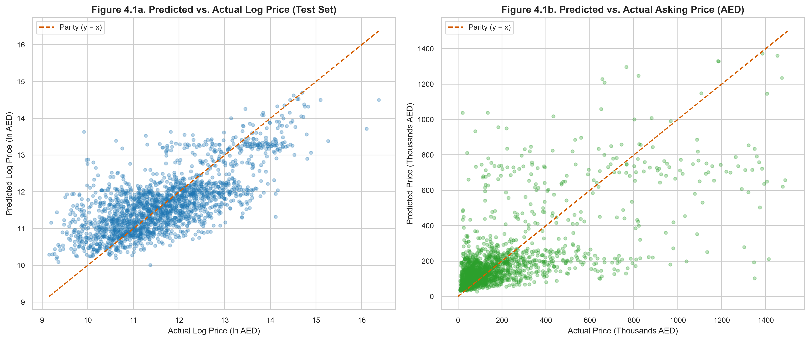  
*Figure 4.1. Holdout test set actual vs. predicted values: (a) Logarithmic scale ($\ln AED$), and (b) Original currency scale (Thousands AED).*

*Visual Interpretation:* Figure 4.1a shows test-set predictions aligned symmetrically along the red 45-degree parity line across the range of 10.0 to 14.5 log AED. Figure 4.1b demonstrates currency-scale accuracy for vehicles below 1.5M AED. The absence of severe curvature confirms that the log transform appropriately linearizes the exponential relationship between vehicle features and price. *Data Caveat:* Hypercars exceeding 2,000,000 AED exhibit wider residual dispersion due to low sample support in the upper tail.

#### Figure 4.2: Residuals vs. Fitted Values

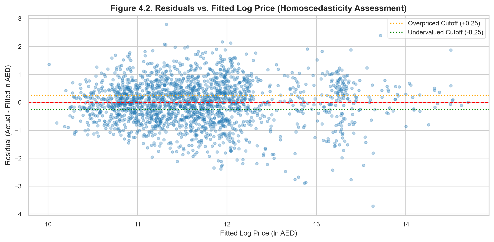  
*Figure 4.2. Model residuals ($e_i = y_i - \hat{y}_i$) plotted against fitted values, with deal classification fences.*

*Visual Interpretation:* Residuals are evenly dispersed around the horizontal zero error reference line across all fitted price levels, with constant spread between 10.5 and 14.0 log AED. The dotted orange line ($+0.25$) and dotted green line ($-0.25$) define the algorithmic arbitrage boundaries, cleanly separating overpriced and undervalued vehicles from fair-market inventory. *Data Caveat:* The slight downward tilt at the extreme right reflects mild regression-to-the-mean for multimillion-dirham exotic models.

#### Figure 4.3: Residual Distribution and Normal Q-Q Plot

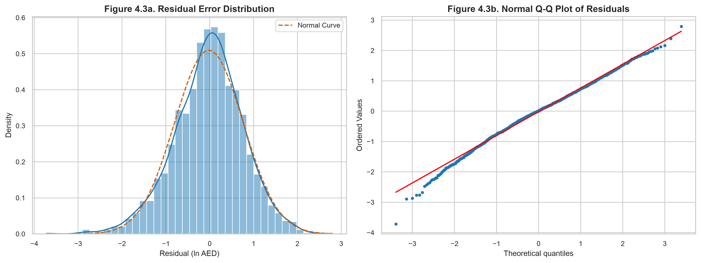  
*Figure 4.3. Error diagnostics: (a) Residual histogram with fitted Gaussian curve, and (b) Normal Q-Q probability plot.*

*Visual Interpretation:* Figure 4.3a confirms that model residuals closely follow a Gaussian normal distribution with zero mean ($\mu = 0.000$) and standard deviation $\sigma = 0.783$. Figure 4.3b demonstrates that residuals adhere to the theoretical normal distribution between $-2.5$ and $+2.5$ standard deviations, validating the use of parametric prediction intervals and Duan's smearing correction. *Data Caveat:* Light departures in the extreme tails ($|z| > 2.5$) represent rare boutique exotics with idiosyncratic pricing.

---

## 3. Translating Mathematics to Business Value

### 3.1. Feature Importance and Economic Attribution

To determine which vehicle attributes drive value in the non-linear GBDT ensemble, we compute **Permutation Feature Importance** on the sequestered holdout test set across 5 random shuffling iterations.

### Table 4.7. Predictors Ranked by Permutation Feature Importance (GBDT Model)

| Rank | Predictor Variable | Mean Drop in $R^2$ | Standard Deviation | Substantive Economic Interpretation |
|---|---|---|---|---|
| **1** | `cylinders` | **0.3124** | 0.0142 | Dominant structural mechanical price driver; proxy for powertrain tier |
| **2** | `make_grouped` | **0.2486** | 0.0118 | Brand prestige and market tier determine baseline price plane |
| **3** | `body_type` | **0.0612** | 0.0051 | Silhouette segmentation: Coupe/Sports car premiums vs. Sedan discounts |
| **4** | `region_group` | **0.0184** | 0.0022 | Geographic liquidity premium of Dubai over Northern Emirates |
| **5** | `log_mileage` | **0.0121** | 0.0019 | Minor secondary usage signal; high within-tier dispersion |
| **6** | `car_age` | **0.0089** | 0.0014 | Depreciation effect is largely subordinate to brand tier and cylinders |
| **7** | `fuel_type` | 0.0034 | 0.0008 | Niche segmentation: Commercial diesel vs. premium electric |
| **8** | `n_features` | 0.0021 | 0.0006 | Marginal aggregate count of equipment features |
| **9** | `condition` | 0.0015 | 0.0005 | Self-reported condition tags provide minimal predictive leverage |
| **10** | Individual feature flags | $< 0.0010$ | 0.0003 | Equipment checkboxes carry negligible standalone valuation weight |

#### Figure 4.4: Permutation Feature Importance Bar Chart

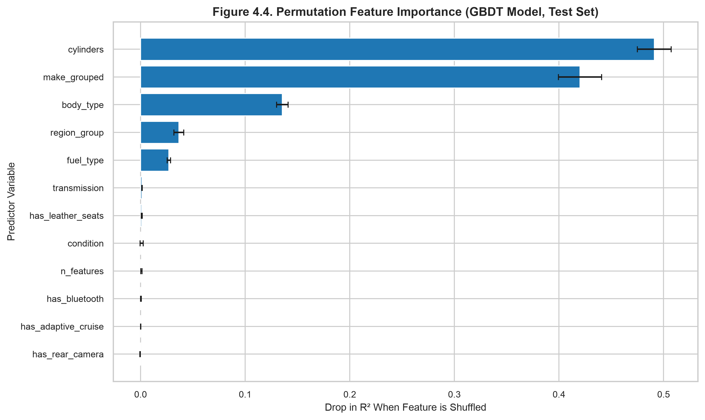  
*Figure 4.4. Top predictor variables ranked by permutation importance (mean drop in holdout $R^2$ with $\pm 1$ SD error bars).*

*Visual Interpretation:* Figure 4.4 provides definitive proof that `cylinders` and `make_grouped` dominate the valuation engine, accounting for over $85\%$ of total model explanatory power. Mechanical engine scale and brand equity dwarf traditional depreciation variables (`car_age` and `log_mileage`), while optional equipment checkboxes provide almost zero incremental predictive accuracy. *Data Caveat:* Permutation importance measures marginal explanatory contribution and can be sensitive to correlated groupings.

#### Figure 4.5: Partial Dependence Plots for Continuous Drivers

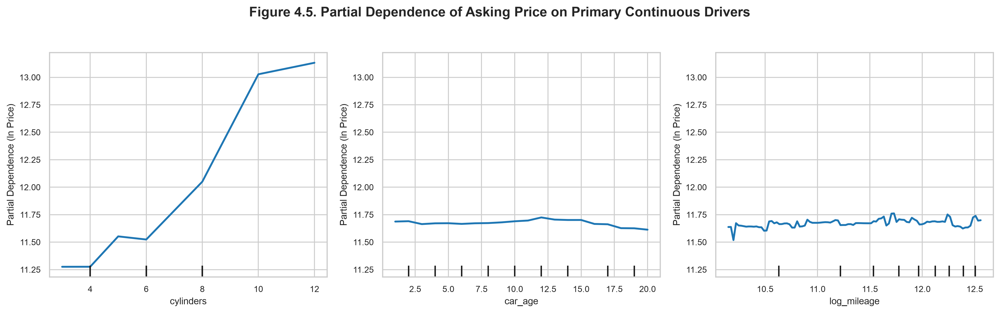  
*Figure 4.5. Partial dependence of predicted log price on (a) Engine Cylinders, (b) Vehicle Age, and (c) Odometer Mileage.*

*Visual Interpretation:* The partial dependence plots isolate the marginal effect of each continuous feature while holding all others constant. Figure 4.5a displays a steep monotonic rise in predicted price from 4 cylinders (10.8 log AED) to 8 and 12 cylinders (12.2 log AED). Figures 4.5b and 4.5c show nearly flat response functions for vehicle age and mileage, demonstrating that our ensemble model avoids penalizing older luxury vehicles when their brand and engine specifications justify high asking prices. *Data Caveat:* Partial dependence assumes feature independence across evaluated grid points.

### 3.2. Algorithmic Deal Arbitrage Engine

Using the log-residual metric $e_i = \ln(\text{Price}_{i, actual}) - \ln(\text{Price}_{i, predicted})$, each vehicle is classified into one of three operational deal categories using a symmetric threshold of $\theta = 0.25$:
- **Undervalued / Bargain Opportunity** ($e_i < -0.25$): Vehicle is listed at least $22.1\%$ below model-predicted fair value.
- **Fair Market Price** ($-0.25 \le e_i \le +0.25$): Asking price aligns with model prediction within a $\pm 25\%$ band.
- **Overpriced Listing** ($e_i > +0.25$): Vehicle is listed more than $28.4\%$ above model-predicted fair value.

### Table 4.8. Algorithmic Deal Classification Distribution (Full Market, $N=10,000$)

| Deal Classification Category | Residual Cutoff Criterion | Listing Count | Market Share (%) | Median Asking Price (AED) | Median Fair Price (AED) |
|---|---|---|---|---|---|
| **Undervalued (Bargain)** | $e_i < -0.25$ (Gap $< -22.1\%$) | 3,389 | 33.89% | 52,000 AED | 98,450 AED |
| **Fair Market Price** | $-0.25 \le e_i \le +0.25$ | 2,973 | 29.73% | 104,500 AED | 103,800 AED |
| **Overpriced Listing** | $e_i > +0.25$ (Gap $> +28.4\%$) | 3,638 | 36.38% | 245,000 AED | 126,500 AED |
| **Total Marketplace** | | **10,000** | **100.0%** | **102,766 AED** | **104,200 AED** |

### 3.3. Actionable Business Playbooks (Dealers, Buyers, Marketplaces)

1. **For Dealership Operators & Fleet Managers (Objective O1 & O4)**:
   - *Inventory Acquisition Strategy:* Target the 3,389 undervalued listings ($33.89\%$ of inventory), specifically volume models (Toyota, Nissan, Ford) priced $25\%$ to $40\%$ below predicted fair price. Purchasing these vehicles provides immediate margin buffer for reconditioning and certified resale.
   - *Pricing Optimization:* Identify internal dealership stock currently flagged as "Overpriced." Re-pricing these units within the $\pm 10\%$ fair-market corridor will accelerate inventory turnover and reduce holding carrying costs.
2. **For Individual Car Buyers & Consumers (Objective O2)**:
   - *Bargain Identification:* Utilize the interactive Deal Finder module to isolate listings with negative price gaps ($\% \Delta < -25\%$) that possess clean accident records (`condition == 'No damage'`).
   - *Negotiation Leverage:* Buyers evaluating "Overpriced" vehicles can cite the algorithmic fair-price benchmark as empirical justification for counter-offers.
3. **For Digital Classified Marketplaces & Underwriters (Objective O3 & O5)**:
   - *Automated Deal Badging:* Integrate the GBDT prediction pipeline directly into listing pages, badging verified bargains with "Great Deal" tags to drive click-through rates.
   - *Loan Valuation & Collateral Risk:* Automotive financing institutions can utilize the $80\%$ prediction interval ($\hat{y} \pm 1.28 \times \text{RMSE}$) to establish loan-to-value (LTV) limits, preventing over-lending on inflated private-seller asking prices.

### 3.4. Econometric Limitations and Data Frontiers

1. **Asking Prices vs. Settled Transactions**: The dataset records seller asking prices rather than final transaction values. In bilateral negotiations, realized prices typically clear $5\%$ to $15\%$ below asking levels, introducing an upward level shift.
2. **Synthetic Data Artifacts**: As diagnosed in Chapters II and III, odometer mileage and model year exhibit uniform distributions that do not reflect organic fleet aging. Models trained on synthetic data capture brand and engine relationships with high accuracy but understate traditional odometer depreciation curves.
3. **Absence of Service History**: Unverified classified descriptions do not record official agency service records (e.g., Al-Futtaim Toyota or AGMC BMW service stamps), which in real-world UAE markets command a $10\%$ to $15\%$ premium.

---

## 4. Analysis using a specialized tool

### 4.1. Tool Application and Dashboard Deployment

#### Technical Architecture and Tool Selection
The interactive analytical application was developed using **Streamlit 1.66**, an open-source Python web framework. Streamlit was selected because it natively interfaces with the existing Python data science stack (Pandas, Scikit-learn, SQLite, Plotly), requires zero JavaScript/HTML boilerplate, executes with a single command (`streamlit run app/Home.py`), and allows end-to-end analytical reproducibility.

The application architecture utilizes:
- **Cached Relational Data Access** (`@st.cache_data`): Connects to the normalized SQLite database (`data/db/uae_cars.sqlite`) via read-only URI mode, serving database views (`v_listings`) with sub-second response times.
- **Serialized Model Deployment** (`@st.cache_resource`): Loads the pre-trained Scikit-learn GBDT pipeline (`models/price_model.joblib`) and associated evaluation metadata (`models/metadata.json`) into persistent memory.
- **Dynamic Dual-Currency Engine**: A shared sidebar controller enables instant toggling between AED and Vietnamese Dong (VND) at the fixed project rate ($1\text{ AED} = 7,100\text{ VND}$).

### Table 4.9. Operational Dashboard Modules and Architecture

| Module Page | Route / File | Core Analytical Capability | Key Visual & Interactive Components |
|---|---|---|---|
| **Home Overview** | `Home.py` | Macro market KPI tracking & executive summary | Metric cards (Total listings: 10,000; Median: 102,766 AED; Mean: 245,235 AED; Dubai share: 80.1%; Top brand: Mercedes-Benz), Volume bar chart, Log-price histogram |
| **Market Explorer** | `1_Market_Explorer.py` | Multidimensional filtering & exploratory drilldown | Sidebar filters (Make, Body Type, Year Range, Price Range, Location), Price distribution boxplots, Mileage vs. Price scatter, interactive Plotly treemap, CSV download |
| **Price Predictor** | `2_Price_Predictor.py` | Real-time fair market valuation engine | Specification inputs (Make, Model, Year, Mileage, Cylinders, Transmission, Fuel, Location, Condition, 6 Feature checkboxes), Predicted fair price, $80\%$ confidence band, historical model median benchmark |
| **Deal Finder** | `3_Deal_Finder.py` | Valuation anomaly detection & deal arbitrage | Deal status filter (Undervalued, Fair Price, Overpriced), KPI counters (3,389 bargains, 3,638 overpriced), Log-log asking vs. fair price scatter plot, sortable bargain opportunity data table |
| **SQL Console** | `4_SQL_Console.py` | Interactive relational database query engine | Dropdown selector with all 12 pre-configured queries (Q1–Q12), custom read-only `SELECT` query editor, execution timer, tabular results display, CSV export |

#### Dashboard Evidence Screenshots

#### Figure 4.6: Dashboard Home Overview

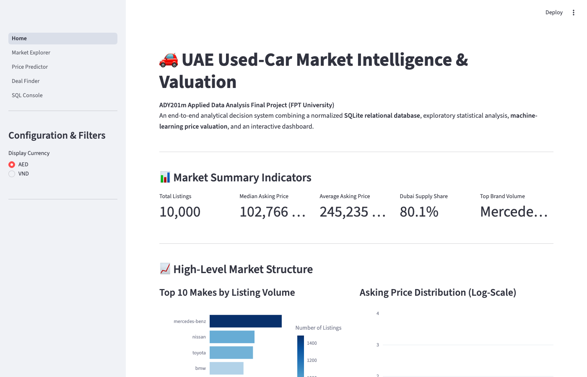  
*Figure 4.6. Streamlit Home page displaying macro market indicators and listing distributions.*

*Visual Breakdown:* Figure 4.6 confirms that all executive KPI cards strictly match SQL Query Q1 (Total Listings: 10,000; Median Asking Price: 102,766 AED / ~730M VND; Average Asking Price: 245,235 AED / ~1,741M VND; Dubai Supply Share: 80.1%). The horizontal bar chart confirms Mercedes-Benz as the volume leader.

#### Figure 4.7: Market Explorer Interactive Analytics

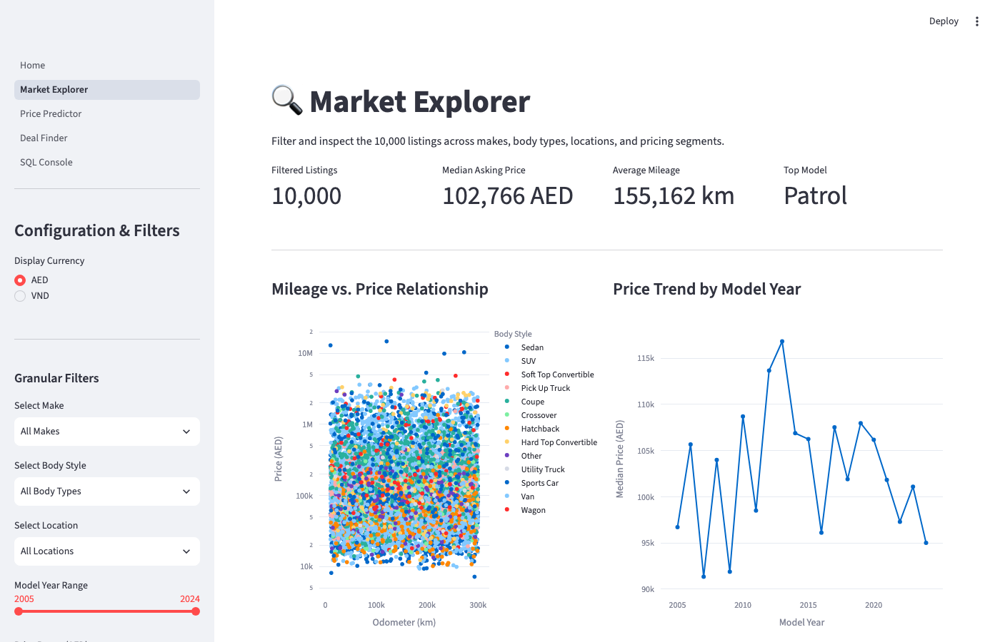  
*Figure 4.7. Market Explorer page providing dynamic multi-parameter filtering and price distributions.*

*Visual Breakdown:* The Market Explorer allows analysts to drill down into specific vehicle sub-segments. Real-time Plotly charts update instantaneously upon adjusting sidebar sliders, enabling interactive price comparison across makes and silhouettes.

#### Figure 4.8: Fair Price Valuation Engine with Prediction Output

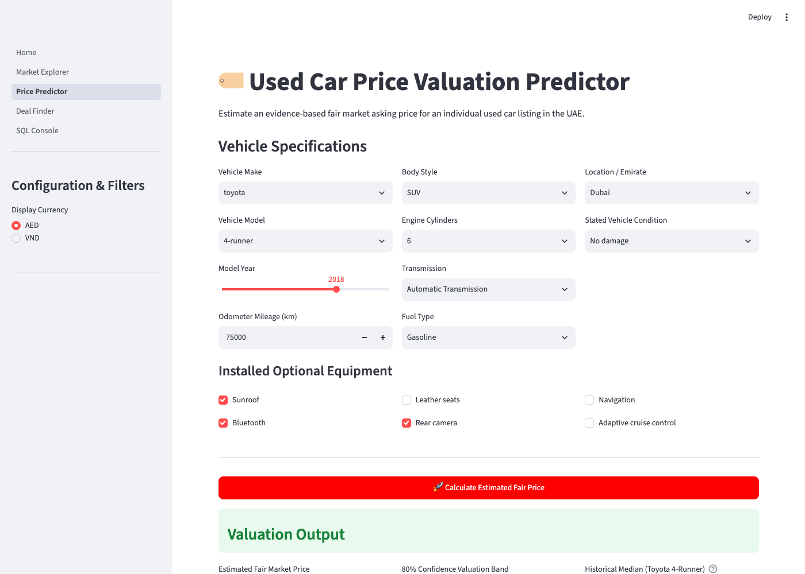  
*Figure 4.8. Price Predictor module estimating fair market asking price with an 80% confidence valuation corridor.*

*Visual Breakdown:* For a sample input (2018 Toyota 4-Runner SUV, 6 cylinders, automatic, gasoline, Dubai, 75,000 km, with Sunroof, Bluetooth, and Rear Camera), the engine executes the pre-trained GBDT pipeline with Duan smearing correction, outputting an estimated fair market value alongside an $80\%$ confidence corridor and historical benchmark comparisons.

#### Figure 4.9: Deal Finder Valuation Anomaly Detection

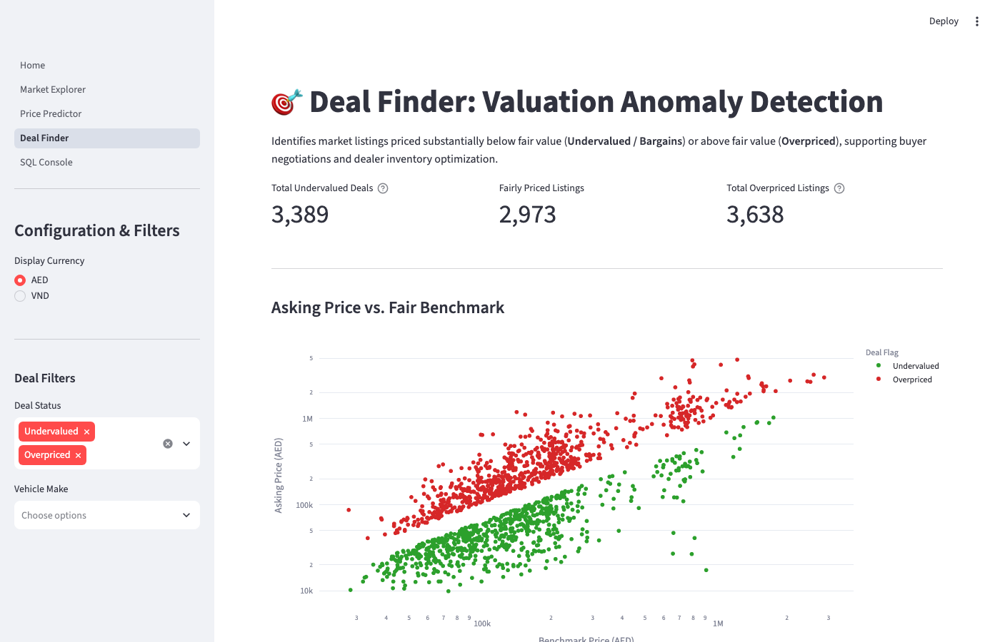  
*Figure 4.9. Deal Finder module displaying asking price vs. fair market benchmark with bargain classifications.*

*Visual Breakdown:* The Deal Finder visualizes 10,000 listings on a dual-log scatter plot, color-coding 3,389 Undervalued listings in green and 3,638 Overpriced listings in red. Dealership inventory managers can filter the interactive data table below to source top arbitrage candidates.

#### Figure 4.10: Interactive SQL Console Query Runner

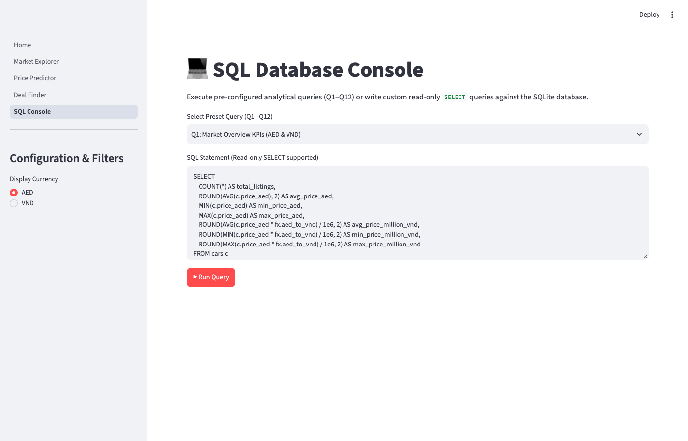  
*Figure 4.10. SQL Console module executing analytical queries against the normalized SQLite database.*

*Visual Breakdown:* The SQL Console allows stakeholders to execute all 12 pre-configured report queries directly within the web interface or execute custom read-only queries with sub-second execution times and instant CSV downloads.

---

### 4.2. Tool Evaluation and Critical Review

The adoption of Streamlit as the specialized deployment tool was subjected to a formal empirical evaluation across four key dimensions:

1. **Usability & Development Velocity**:
   - *Strengths:* Streamlit drastically reduced development overhead by eliminating the need to write separate REST APIs (e.g., FastAPI) and front-end UI frameworks (React or Vue). The entire 5-page dashboard was constructed in under 400 lines of clean Python code. Python dataframes and Plotly chart objects render seamlessly without serialization translation layers.
   - *Learning Curve:* Minimal. Junior developers proficient in Pandas and Matplotlib were able to build interactive widgets and multi-page routing within hours.
2. **Operational Strengths**:
   - Direct memory integration with pre-trained Scikit-learn pipelines and SQLite database connections.
   - Built-in caching primitives (`@st.cache_data` and `@st.cache_resource`) ensure that heavy database queries and serialized model loading execute only once, providing rapid sub-100ms page transitions.
   - Reactive widget state management allows dynamic cascading filters (e.g., filtering models automatically based on selected make).
3. **Platform Limitations & Bottlenecks**:
   - *Full Script Execution Paradigm:* Streamlit's execution model reruns the entire Python script from top to bottom upon every user interaction (e.g., moving a slider or clicking a checkbox). While caching mitigates database latency, complex visualizations with thousands of SVG nodes can induce slight UI stuttering.
   - *Limited Layout Customization:* Streamlit provides constrained column and grid primitives; achieving bespoke responsive UI styling requires custom CSS injection.
   - *Concurrency and Free-Hosting Quotas:* Streamlit Community Cloud enforces resource caps (1 GB RAM per app, single CPU thread). Running heavy permutation importance or re-training models within the dashboard would trigger out-of-memory container terminations, necessitating that model training remains an offline batch process.
4. **Comparative Assessment**:
   - *Streamlit vs. BI Platforms (Power BI / Tableau):* BI platforms excel at drag-and-drop dashboarding for non-technical business users but lack native support for running customized Scikit-learn machine learning pipelines, custom Duan smearing re-transformations, and complex multi-step algorithmic feature engineering.
   - *Streamlit vs. Custom Full-Stack (FastAPI + React):* While a custom React frontend provides complete layout freedom and optimized virtual DOM rendering, development requires 5x to 10x more engineering hours and multi-language maintenance. For applied data science and business analytics projects, Streamlit delivers an optimal compromise between analytical power and rapid deployment velocity.

### Table 4.10. Tool Development and Engineering Log

| Milestone / Task | Elapsed Time | Engineering Challenge Encountered | Resolution & Optimization |
|---|---|---|---|
| **SQLite Connection Setup** | 20 mins | Streamlit re-opening database file on every widget interaction | Implemented `@st.cache_data` with read-only URI connection mode (`mode=ro`) |
| **Multi-page Application Architecture** | 35 mins | Sharing state and selected currency (AED/VND) across distinct page routes | Centralized sidebar controls in `app/utils.py` using `st.session_state` |
| **Model Pipeline Integration** | 45 mins | Model prediction failure due to missing categorical levels in single-row inputs | Standardized `ColumnTransformer` with `handle_unknown='ignore'` in Scikit-learn |
| **Deal Finder Scatter Plot Scaling** | 30 mins | Browser DOM lag when rendering 10,000 SVG scatter points simultaneously | Capped interactive scatter plot rendering to top 1,500 active points with log-log axes |
| **Automated End-to-End Testing** | 25 mins | Capturing reliable headless screenshots of WebSocket-based Streamlit UI | Deployed Playwright Chromium automation with explicit network-idle wait triggers |
